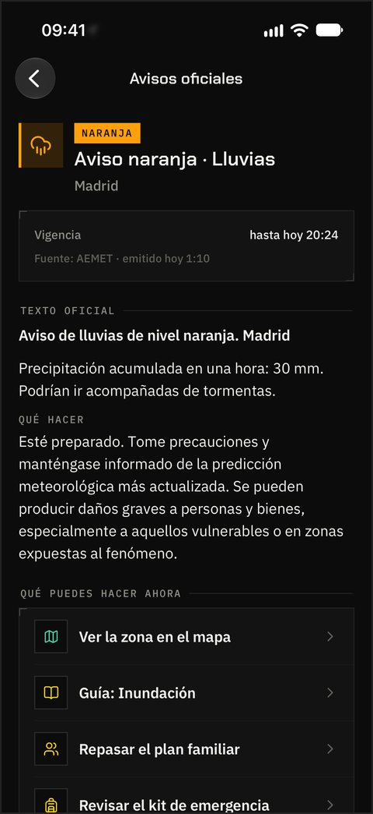

<p align="center">
  
</p>

<h1 align="center">Nomad Pocket</h1>

<p align="center">
  <b>Navegador GPS y guías de supervivencia en tu móvil, aunque haya un apagón.</b><br>
  Prepáralo hoy mientras tienes conexión; mañana funciona sin internet, sin cobertura y sin luz.<br>
  Navegación en CarPlay, hospitales cercanos, avisos oficiales, una guía de emergencias, Wikipedia, cursos y una IA que vive en tu teléfono. Gratis y de código abierto.<br>
  <sub>Inspirada en <a href="https://github.com/Crosstalk-Solutions/project-nomad">Project N.O.M.A.D.</a> de Crosstalk Solutions.</sub>
</p>

<p align="center">
  <a href="https://apps.apple.com/app/nomad-pocket-kit-offline/id6826502392"></a><br>
  <sub>Android · Google Play: muy pronto</sub>
</p>

<p align="center">
  
  
  
  
  
  
</p>

<p align="center">
  <a href="https://nomad-pocket.app/">nomad-pocket.app</a> · <a href="README.md">🇬🇧 Read in English</a>
</p>

<p align="center">
  
</p>

---

## ¿Y si mañana se cae internet?

El 28 de abril de 2025, España y Portugal se quedaron sin luz durante horas. Las antenas de
telefonía aguantaron lo que duraron sus baterías y muchos móviles se quedaron sin datos ni
cobertura: sin mapas, sin buscador, sin forma de consultar qué hacer. Basta un apagón, un
ciberataque, una tormenta o un fallo informático masivo (en julio de 2024 una sola
actualización defectuosa tumbó millones de ordenadores en todo el mundo) para que tu móvil
enmudezca justo cuando más lo necesitas.

**Nomad Pocket guarda lo esencial en el propio teléfono**, para que siga funcionando cuando
todo lo demás falla:

- **Apagón**: sin luz, las antenas aguantan poco. Tus mapas, guías y plan siguen en tu móvil.
- **Caída de internet o ciberataque**: falla tu operador o un gran servicio en la nube. Nada de lo que llevas depende de ellos.
- **Tormenta o inundación**: mientras hay conexión, los avisos oficiales te dicen lo que viene; cuando el temporal tumba la red, sabes dónde está el hospital, la farmacia o el agua potable.
- **Sin cobertura**: montaña, mar, una carretera perdida: rutas y respuestas sin una sola raya.
- **De viaje**: en el extranjero sin roaming ni SIM local, con el mapa del país y el número de emergencias del país en el que estás.

Sin cuenta, sin anuncios, y nada de lo que llevas necesita conexión ni servidor. Lleva la idea de
[Project N.O.M.A.D.](https://github.com/Crosstalk-Solutions/project-nomad) (un servidor de
conocimiento sin conexión) al dispositivo que todos llevamos encima.

## Listo en un minuto

<table>
  <tr>
    <td align="center" width="40%"></td>
    <td>
      <b>1. Elige tu país.</b> La app te propone un kit a la medida de tu país y del espacio libre
      de tu teléfono: el mapa con sus rutas, las guías esenciales, Wikipedia y el asistente.
      Desactiva lo que no quieras y elige si quieres avisos oficiales.<br><br>
      <b>2. Descárgalo con wifi.</b> Déjalo descargando con la app abierta (en iPhone también sigue
      en segundo plano). Inicio te dice lo preparado que estás y lo que falta, para completarlo
      mientras aún hay red.<br><br>
      <b>3. Úsalo sin conexión.</b> En modo avión, en un apagón o en mitad del monte. Cuando haya
      versiones nuevas de tus mapas, archivos o cursos, te avisa, y conserva la copia antigua hasta
      que la nueva está lista.
    </td>
  </tr>
</table>

## Qué llevas dentro

**200+** fichas de emergencia · **90** archivos de conocimiento · **14** cursos · **0 €**, sin compras ni anuncios

### 🆘 Emergencias

- **El número de emergencias del país en el que estás** en un botón grande en Inicio, y un botón
  SOS en el mapa. La app sabe en qué país estás por tu posición, sin conexión (235 países y
  territorios), y donde no hay un número único te dice a cuál llama: ambulancia o policía.
- **Emergencias cerca**: hospitales y centros de salud, farmacias, desfibriladores, policía y
  bomberos, agua potable y fuentes, refugios y puntos de encuentro, gasolineras y supermercados,
  ayuntamientos y embajadas. Lo más cercano primero, con la distancia y la dirección de cada uno.
  Un toque y te lleva hasta allí; otro, y llamas, si el mapa tiene su teléfono.
- **Completado con datos oficiales**: en más de 25 países (España, Francia, Japón, Reino Unido,
  Estados Unidos, Canadá, Australia, México, Corea del Sur…), las farmacias, hospitales y centros
  de salud que faltan en OpenStreetMap se añaden desde los registros sanitarios oficiales. En
  España, del Ministerio de Sanidad y de las comunidades autónomas: unas 6.800 farmacias, 7.800
  centros de salud y consultorios y 120 hospitales que no estaban en el mapa.
- **Comparte tu posición exacta** por mensaje: coordenadas, UTM, precisión y un enlace al mapa. El
  GPS no necesita datos: sabes dónde estás aunque no haya cobertura.
- **Guía de emergencias**: más de 200 fichas (reanimación, hemorragias, quemaduras,
  atragantamiento, incendios, inundaciones, terremotos…), textos breves pensados para leerse con
  prisa. Más de la mitad son textos oficiales, copiados o traducidos fielmente (CDC, FEMA,
  Protección Civil, Ministerio de Sanidad…); el resto los hemos escrito siguiendo guías oficiales
  (ERC 2025, NHS…), y la ficha lo dice. Cada ficha indica su fuente y su licencia. En la app desde
  el primer minuto, sin descargar nada.

<table>
  <tr>
    <td align="center" width="33%"></td>
    <td align="center" width="33%"></td>
    <td align="center" width="33%"></td>
  </tr>
</table>

<sub>Primeros auxilios e información médica: en iPhone y iPad. En Android, la guía conserva sus otras más de 100 fichas (incendios, inundaciones, terremotos, fugas de gas…).</sub>

### 🔔 Avisos oficiales

- **Los avisos de donde estás**: cuando un servicio oficial emite un aviso naranja o rojo para tu
  zona, o hay un terremoto fuerte cerca, el móvil te avisa, para que te prepares mientras aún hay
  conexión. Tú eliges desde qué nivel (amarillo, naranja o rojo) y si quieres terremotos.
- **Fuentes oficiales**: AEMET en España, el Servicio Meteorológico Nacional (NWS) en Estados
  Unidos, MeteoAlarm en 35 países europeos (con el servicio meteorológico nacional que emitió cada
  aviso), las alertas naranjas y rojas de desastres de GDACS en el resto del mundo, y los
  terremotos de USGS y EMSC en todas partes (magnitud 4,5 o más a menos de 100 km, o 6 o más a
  menos de 500 km).
- **En cuanto se publican**: un pequeño servidor nuestro consulta las fuentes cada minuto y envía
  la notificación; la app también lo comprueba por su cuenta en segundo plano. En iPhone, los
  avisos rojos, los tsunamis y los terremotos más fuertes llegan como notificaciones urgentes
  (Time Sensitive).
- **Qué hacer**: cada aviso muestra el texto oficial (en tu idioma cuando el servicio lo publica),
  quién lo emitió y hasta cuándo, y te lleva a la zona en el mapa, a la ficha de la guía para ese
  peligro, a tu plan familiar, a tu mochila y al número de emergencias. Inicio muestra los avisos en
  vigor donde estás, y puedes preguntarle al asistente «¿hay avisos cerca?» o si alguno cruza tu ruta.
- Desactivados salvo que los actives (el asistente de bienvenida te lo pregunta). Necesitan
  conexión para llegar, y los de MeteoAlarm necesitan las notificaciones y la ubicación permitidas.
  Nomad Pocket no emite avisos: son los de los servicios oficiales y pueden llegar tarde o no
  llegar. En una emergencia, sigue las alertas de tus autoridades en el móvil y llama al número de
  emergencias.

<p align="center">
  
</p>

### 🗺️ Mapas y navegación

<table>
  <tr>
    <td align="center" width="40%"></td>
    <td>
      <b>Tu país entero en el móvil</b>: cada calle, camino y edificio, en una sola descarga que
      trae también sus rutas, sus puntos de emergencia y cada calle y lugar para el buscador, con los
      números de portal allí donde OpenStreetMap los tiene.<br><br>
      <b>Rutas en coche, a pie o en bici</b> sin red: indicaciones por voz que siguen guiándote con
      la pantalla bloqueada, una cámara que sigue la carretera, la lista de giros y una ruta nueva si
      te sales. En coche, el límite de velocidad de la vía allí donde OpenStreetMap lo tiene, y un
      aviso si lo superas. Con los dos países descargados, una sola ruta cruza la frontera, ferris
      incluidos. Donde no llega ningún camino, una flecha te marca la dirección en línea recta.<br><br>
      <b>Busca sin internet</b>: calles, números de portal, lugares y categorías («farmacia»), con
      lo que tienes cerca primero, tus lugares recientes y coordenadas en decimal, en grados o en
      UTM. Toca cualquier punto del mapa para ver qué es, su dirección y, cuando el mapa los tiene,
      su teléfono y si está abierto ahora.<br><br>
      Brújula, coordenadas y UTM, lugares guardados y unidades que siguen a tu país (km o millas).
      Mapas de 241 países y territorios, rutas en 233, y un mapa básico del mundo incluido desde el
      primer segundo. Estados Unidos, Canadá y Rusia van por regiones.
    </td>
  </tr>
</table>

### 🚗 CarPlay

<table>
  <tr>
    <td align="center" width="70%"></td>
    <td align="center" width="30%"></td>
  </tr>
</table>

- **Tu ruta, en la pantalla del coche**: conecta el iPhone y Nomad Pocket aparece en CarPlay con
  el mapa sin conexión y la navegación giro a giro, con indicaciones por voz. También sin
  cobertura, en mitad de la carretera.
- **Desde el coche**: busca un destino (o «gasolineras en la ruta»), elige un lugar guardado o el
  hospital, la farmacia, la policía o la gasolinera más cercanos, mira la distancia y el tiempo del
  viaje, y en marcha.
- **Como en el móvil**: el mismo mapa, la flecha azul y una cámara que sigue la ruta con suavidad;
  maniobras con la salida de la rotonda, distancia y hora de llegada, tu velocidad y la señal del
  límite de la vía.
- **Móvil y coche a la par**: empieza el viaje en cualquiera de los dos; al terminarlo en uno,
  termina en los dos.

### 📚 Biblioteca

- **Wikipedia** en español o en inglés, a la medida de tu espacio: sus 50.000 mejores artículos
  resumidos (~250 MB) o completos (1,2 GB en español, 2,7 GB en inglés), hasta la enciclopedia
  entera.
- **80 archivos** de supervivencia, agua y alimentos, agricultura, reparaciones, educación,
  informática y, en iPhone y iPad, medicina, agrupados en colecciones con niveles (Esencial,
  Estándar, Completo). El kit descarga lo esencial de cada colección, y nada se descarga dos veces.
  Y miles más del catálogo de [Kiwix](https://kiwix.org) en español e inglés, o tus propios
  archivos ZIM.
- **Bibliotecas de guías en PDF** (potabilizar agua, nudos, alimentos, después de un desastre…),
  en las que también puedes buscar por dentro.
- Búsqueda de texto completo en todos tus libros y sus PDF, índice, buscar en la página, tamaño de
  letra, marcadores y lectura en oscuro o en modo papel. **14 cursos** con seguimiento del progreso.
- **Pásalo sin internet**: envía un archivo descargado a otro móvil (AirDrop, Quick Share,
  Archivos) y añádelo allí con «Importar un archivo ZIM», también desde una tarjeta SD.

### ✨ Asistente sin conexión

- **Una IA que no necesita internet**: pregúntale «¿cómo potabilizo agua?» en mitad de la nada y
  responde con tu biblioteca, con fuentes que puedes abrir. Busca en tus archivos (también en sus
  guías en PDF, citadas por página), en la guía de emergencias y en tu plan familiar («¿dónde nos
  reunimos?»). Si no encuentra nada, te lo dice en vez de responder de memoria.
- **Pregúntale por el mapa**: «¿dónde está la farmacia más cercana?», «llévame al hospital»,
  «¿dónde estoy?» (con lo que tienes que decir al llamar a emergencias y un SMS listo para enviar),
  «¿llego antes de que anochezca?», «gasolineras de camino a Valencia» o «¿hay avisos cerca?».
  Responde con tarjetas hechas con tus mapas sin conexión: nombres, distancias, tiempos y
  teléfonos salen de los datos, nunca de la IA. Funciona incluso sin modelo.
- **Modelos abiertos que funcionan en tu teléfono** con llama.cpp: Qwen3.5 (0.8B, 2B o 4B) o
  Gemma 4 E2B, de 533 MB a 3,1 GB; la app te recomienda el que la memoria de tu teléfono puede
  mover. En iPhone y iPad con Apple Intelligence (iOS 26 o posterior) también puede usar el modelo
  de Apple sin descargar nada, aunque el modelo recomendado responde mejor. En Android, los modelos
  descargables son la única opción.
- Las preguntas urgentes (reanimación, atragantamiento, un incendio, una fuga de gas…) reciben la
  ficha de la guía tal cual, no una versión de la IA, incluso sin modelo; en Android no responde
  preguntas de salud y te da el número de emergencias. Dicta tus preguntas: la voz se procesa en el
  dispositivo (en Android, desde Android 13). Las conversaciones se guardan en el móvil, y nada de
  lo que preguntas sale de él.

<table>
  <tr>
    <td align="center" width="50%"></td>
    <td align="center" width="50%"></td>
  </tr>
</table>

### 🎒 Plan y mochila

<table>
  <tr>
    <td align="center" width="40%"></td>
    <td>
      <b>Tu familia sabe qué hacer</b>: un punto de encuentro principal y otro de reserva en el
      mapa, contactos con botón de llamada, números importantes, la medicación, las alergias y el
      grupo sanguíneo de cada uno (en iPhone y iPad) y notas de la casa (dónde está la llave del
      gas). También en PDF para imprimir. Tu plan solo sale del móvil si tú lo compartes, o dentro
      de las copias de seguridad del sistema.<br><br>
      <b>Una mochila de emergencia a la medida de tu hogar</b>: adultos, niños y mascotas, para 72
      horas, una semana o dos. Agua (4 litros por persona y día), comida y al menos 30 días de
      medicación calculados para ti, una lista que puedes ampliar y un recordatorio local antes de
      que algo caduque.<br><br>
      <b>Tu preparación</b> en Inicio: mapa, guías, Wikipedia, asistente, plan y mochila, cada uno
      con su estado, y una tarjeta cuando hay avisos oficiales donde estás o tus datos tienen meses
      y hay una versión nueva.
    </td>
  </tr>
</table>

## Privada por diseño

Sin cuenta. Sin anuncios. Sin analítica. Sin rastreo. Tu plan, tus contactos y lo que le
preguntas al asistente se quedan en tu móvil, y tu ubicación también, salvo que la compartas o
actives los avisos oficiales. Mapas, guías, biblioteca y asistente funcionan sin ningún servidor.
La app se conecta para descargar el contenido que eliges, de servidores públicos (Kiwix y sus
espejos, GitHub Releases y Hugging Face; Protomaps y servidores públicos de Overpass solo para el
raro mapa que no viene hecho, y Overpass solo ve los límites de una región), y para buscar
actualizaciones: al abrirla con conexión consulta en GitHub los catálogos de países, así que GitHub
ve tu dirección IP, y una vez por semana pregunta a Kiwix por versiones nuevas de tus archivos,
enviando solo sus nombres. Las búsquedas en «Explorar» van a Kiwix. Las páginas de los libros que
lees no pueden acceder a la red.

**Con los avisos oficiales activados** (tú decides), el móvil descarga los avisos de AEMET,
GDACS, USGS y EMSC, que no reciben tu ubicación, y en Estados Unidos pide al Servicio
Meteorológico Nacional los avisos de tu zona con una posición redondeada a unos 5 km. Además se
registra en nuestro pequeño servidor de avisos (`server/alerts`, en Firebase, en la UE) para que
los avisos lleguen al momento: el servidor guarda el identificador de notificaciones, la cuadrícula
de unos 10 km en la que estás (nunca tu posición), tu país, idioma, zona horaria y ajustes de
avisos, y los borra al desactivarlos o tras 90 días sin renovarse. En Android, el identificador de
notificaciones lo dan los servicios de Google Play del propio teléfono y Firebase Installations;
la app no incluye ninguna librería de Google.
[Política de privacidad](https://nomad-pocket.app/privacy.html).

## Preguntas frecuentes

<details>
<summary><b>¿De verdad funciona sin internet?</b></summary>

Sí. Solo necesitas conexión para descargar el contenido (mejor con wifi) y para buscar
actualizaciones. Después, mapas, rutas, búsqueda de calles, puntos de emergencia, guía,
biblioteca y asistente funcionan en modo avión. Solo los avisos oficiales necesitan conexión
para llegar.
</details>

<details>
<summary><b>¿El GPS funciona sin datos?</b></summary>

Sí. El GPS recibe la señal de los satélites, no de internet, así que el mapa te sitúa aunque
no haya cobertura. La primera posición puede tardar algo más que con datos.
</details>

<details>
<summary><b>¿Me avisa de tormentas o terremotos?</b></summary>

Sí, si activas los avisos oficiales. Muestra los avisos que publican AEMET (España), el Servicio
Meteorológico Nacional de Estados Unidos, MeteoAlarm (35 países europeos) y GDACS en el resto del
mundo, además de los terremotos de USGS y EMSC, y te notifica los naranjas y rojos de tu zona en
cuanto se publican. Los avisos necesitan conexión para llegar. Nomad Pocket no emite avisos: en
una emergencia, sigue las alertas de tus autoridades en el móvil y llama al número de emergencias.
</details>

<details>
<summary><b>¿Cuánto espacio ocupa?</b></summary>

Tú eliges. El asistente de bienvenida propone un kit para tu país y tu espacio libre, y puedes
desactivar cada pieza. Un país ocupa desde menos de 1 MB (una isla pequeña) hasta unos 11 GB
(Alemania); España, unos 4,7 GB. Estados Unidos, Canadá y Rusia van por regiones, la mayor de unos
12 GB. La app te dice el tamaño exacto antes de descargar.
</details>

<details>
<summary><b>¿Funciona en mi país?</b></summary>

Hay mapas de 241 países y territorios, y rutas, búsqueda de calles y puntos de emergencia en 233;
un mapa del mundo viene incluido desde el primer segundo. En más de 25 países, las farmacias,
hospitales y centros de salud se completan con registros oficiales. La app y su biblioteca están en
español e inglés (tus propios archivos ZIM pueden estar en cualquier idioma). Los nombres del mapa
en algunas escrituras (bengalí, tamil, birmano, jemer…) todavía no se dibujan; el buscador y las
listas sí los muestran.
</details>

<details>
<summary><b>¿Funciona con CarPlay?</b></summary>

Sí. Al conectar el iPhone al coche, Nomad Pocket aparece en CarPlay con el mapa de tu país:
busca destinos, encuentra emergencias cercanas y te guía por voz, todo sin conexión. Android
Auto todavía no.
</details>

<details>
<summary><b>¿Qué dispositivos son compatibles? ¿Y Android?</b></summary>

iPhone y iPad con iOS 16.4 o posterior, en el App Store. Android 8.0 o posterior está en prueba
cerrada en Google Play y se abrirá a todo el mundo cuando Google la apruebe, con mapas, rutas,
emergencias, biblioteca, plan y asistente. Los primeros auxilios y la información médica solo están
en iPhone y iPad, así que Android tiene 103 fichas de la guía, 79 archivos y 12 cursos. El
asistente usa un modelo abierto que descargas desde la app (desde 533 MB; los más grandes necesitan
más memoria) o, en los iPhone y iPad que lo tienen, Apple Intelligence.
</details>

<details>
<summary><b>¿Sustituye a los servicios de emergencia?</b></summary>

No. Te ayuda cuando no hay red, pero la IA puede equivocarse y la información médica no
sustituye a un profesional. Los avisos oficiales no sustituyen a las alertas de tus autoridades en
el móvil. Si puedes, llama siempre al número de emergencias.
</details>

## Código abierto, datos abiertos

Nomad Pocket es software libre con licencia **GPL-3.0 o posterior**, construido por completo
sobre conocimiento abierto. La GPL cubre el código del proyecto; los datos de abajo conservan
su propia licencia:

| Contenido | Fuente | Licencia |
|---|---|---|
| Mapas, rutas, puntos de emergencia, direcciones | Colaboradores de [OpenStreetMap](https://www.openstreetmap.org), vía [Protomaps](https://protomaps.com) y [Geofabrik](https://www.geofabrik.de) | ODbL |
| Más farmacias, hospitales y centros de salud | Registros sanitarios oficiales de 27 países: Ministerio de Sanidad y comunidades autónomas, FINESS de Francia, NHS England, MHLW de Japón y otros ([lista](docs/OFFICIAL_POINTS.md#covered)) | La de cada registro: CC BY 4.0, Licence Ouverte 2.0, OGL, CC0, Ley 37/2007 y otras |
| Avisos meteorológicos y desastres | [AEMET](https://www.aemet.es) (España), [NOAA / National Weather Service](https://www.weather.gov) (EE. UU.), [EUMETNET – MeteoAlarm](https://meteoalarm.org) (Europa), [GDACS](https://www.gdacs.org) (Comisión Europea JRC, OCHA de la ONU) | © AEMET (condiciones de reutilización); dominio público; CC BY 4.0 con las condiciones de MeteoAlarm; CC BY 4.0 |
| Terremotos | [USGS](https://earthquake.usgs.gov), [EMSC-CSEM](https://www.emsc-csem.org) | Dominio público; uso libre citando la fuente |
| Guía de emergencias | Textos oficiales de agencias de EE. UU. (CDC, FEMA, NIH…) y de organismos públicos españoles (Protección Civil, Ministerio de Sanidad, INSST…), y redacción propia | Dominio público; Ley 37/2007; GPL-3.0 o posterior |
| Números de emergencia | [Lista de Wikipedia](https://en.wikipedia.org/wiki/List_of_emergency_telephone_numbers), revisada | CC BY-SA 4.0 |
| Wikipedia y la biblioteca | [Wikipedia](https://www.wikipedia.org) y otros, empaquetados por [Kiwix](https://kiwix.org) | CC BY-SA y otras |
| Visualización del mapa | [MapLibre Native](https://github.com/maplibre/maplibre-native), [Protomaps basemaps](https://github.com/protomaps/basemaps), Noto Sans | BSD-2-Clause, BSD-3-Clause y CC0, OFL-1.1 |
| Motor de rutas | [Valhalla](https://github.com/valhalla/valhalla) | MIT |
| Contornos de países | [Natural Earth](https://www.naturalearthdata.com) | Dominio público |
| IA local | [llama.cpp](https://github.com/ggml-org/llama.cpp), Qwen3.5, Gemma 4 | MIT, Apache-2.0 |
| Motor de lectura | [libkiwix](https://github.com/kiwix/libkiwix), [libzim](https://github.com/openzim/libzim), [Xapian](https://xapian.org), libmicrohttpd | GPL-3.0+, GPL-2.0+, LGPL-2.1+ |

Los paquetes de cada país se construyen a la vista de todos: un
[workflow mensual de GitHub Actions](.github/workflows/country-packages.yml) recorta el mapa
de cada país, construye su grafo de rutas y sus pasos fronterizos, extrae sus puntos de
emergencia, calles, lugares y portales, añade los registros sanitarios oficiales que descarga
[otro workflow mensual](.github/workflows/official-points.yml) y los publica como
[GitHub Releases](https://github.com/franlindebl/nomad-pocket/releases). Cualquiera puede
revisarlos o reconstruirlos.

### Colabora

Las ideas, los avisos de fallos y los pull requests son bienvenidos: lee antes
[CONTRIBUTING.md](CONTRIBUTING.md) (en inglés: contribuciones bajo GPL-3.0 o posterior, cómo
compilar desde un clon limpio, las comprobaciones). Problemas de seguridad:
[SECURITY.md](SECURITY.md). Buenos sitios para empezar:

- **Pruébala en tu móvil** y [abre un issue](https://github.com/franlindebl/nomad-pocket/issues)
  con lo que falló o te confundió.
- **Datos oficiales de tu país**: busca los registros abiertos de farmacias, hospitales y centros
  de salud de tu país y añádelos (`scripts/official/<cc>.py`; lo que publica cada país:
  [docs/OFFICIAL_POINTS_WORLD.md](docs/OFFICIAL_POINTS_WORLD.md)). Los grandes huecos: India,
  China, Indonesia, Pakistán, Nigeria y Brasil.
- **Traducciones**: la app habla español e inglés. Un idioma nuevo supone la interfaz
  (`src/i18n/locales`), los textos del catálogo (`src/data/catalog.json`), los textos del sistema
  (`locales/`) y las fichas de la guía de emergencias (`src/data/guide/`).
- **Contenido**: propón colecciones para el catálogo (`src/data/catalog.json`).

## Estado

En el [App Store](https://apps.apple.com/app/nomad-pocket-kit-offline/id6826502392) para iPhone
y iPad, con CarPlay desde la 2.2 y avisos oficiales desde la 2.4 (al momento, con MeteoAlarm,
desde la 2.5). Android está en prueba cerrada en Google Play y se abrirá a todo el mundo cuando
Google la apruebe. Avance, pendientes y limitaciones conocidas: [docs/PROGRESS.md](docs/PROGRESS.md).

## Para desarrolladores

Expo SDK 58 · React Native 0.88 (New Architecture) · TypeScript · Expo Router · MapLibre con
PMTiles · llama.rn · SQLite. Ocho módulos nativos locales (`modules/`): libkiwix/libzim, rutas
con Valhalla, Apple Foundation Models (iOS), CarPlay, indicaciones habladas, comprobación de
archivos en streaming, y ubicación y notificaciones push sin código de los servicios de Google
Play (Android). El servidor opcional de avisos está en `server/alerts` (Cloud Functions for
Firebase + Firestore); incluye la lógica y los textos de avisos de la app y se despliega desde
`main`. La web se genera con `scripts/site/build.mjs`.

```bash
npm install            # también descarga los frameworks de libkiwix y Valhalla para iOS
npx expo run:ios       # o: npx expo run:android  (build de desarrollo; Expo Go no sirve)
npm test               # tests unitarios
npx tsc --noEmit && npx expo lint && npm run check:i18n
npm run e2e:setup      # una vez: requisitos de la suite de Maestro
npm run e2e            # suite funcional de Maestro en el simulador de iOS
cd server/alerts && npm run check   # servidor de avisos, si lo tocas o tocas el código de avisos de la app
node scripts/site/build.mjs         # regenera la web (site/)
```

Necesita Node 22.13+ o 24.3+ (el mínimo de Expo SDK 58), Xcode (27+ para el simulador de iOS 27
que usan Apple Intelligence y la suite E2E; las compilaciones normales pueden funcionar con Xcode
26) y Android Studio. No hace falta ninguna cuenta para compilar en simulador o emulador. Las
capturas del README se generan a partir de las capturas de las tiendas con
`python3 scripts/site/images.py`. Documentación (en inglés): [Desarrollo](docs/DEVELOPMENT.md) ·
[Arquitectura](docs/ARCHITECTURE.md) · [Guía de estilo](docs/STYLE_GUIDE.md) ·
[Tests E2E](docs/E2E.md) · [Publicación](docs/RELEASE.md) ·
[Android y Google Play](docs/ANDROID_PLAY.md) · [Contribuir](CONTRIBUTING.md) · [Seguridad](SECURITY.md) · [Guía para agentes](CLAUDE.md)

## Aviso

Nomad Pocket es una herramienta de preparación, no sustituye a los servicios de emergencia
ni al consejo médico profesional. Los mapas, los puntos de emergencia y las guías vienen de
fuentes abiertas y pueden estar incompletos o desactualizados, y la IA puede equivocarse. Los
avisos oficiales son los que publican los servicios oficiales: Nomad Pocket no emite avisos, y
pueden llegar tarde o no llegar. En una emergencia, sigue las alertas de tus autoridades en el
móvil y llama siempre a tu número de emergencias.

## Créditos y licencia

Inspirada en [Project N.O.M.A.D.](https://github.com/Crosstalk-Solutions/project-nomad) de
Crosstalk Solutions. Posible gracias a Kiwix, Wikipedia, OpenStreetMap, Protomaps, MapLibre,
Valhalla, llama.cpp, los registros sanitarios oficiales de cada país y los avisos de AEMET,
MeteoAlarm, el NWS, USGS, EMSC y GDACS. Nomad Pocket es un proyecto independiente: no está
afiliada a Crosstalk Solutions, Project N.O.M.A.D. ni a ninguno de estos proyectos u organismos,
ni cuenta con su respaldo.

Copyright (C) 2026 Fran Linde Blázquez y colaboradores. GPL-3.0 o posterior: consulta
[LICENSE](LICENSE). Cada biblioteca, fuente y conjunto de datos incluido, con su versión,
copyright y texto de licencia, está en la app, en **Ajustes › Créditos y licencias** (generado
con `node scripts/licenses.mjs`). Datos de mapas © colaboradores de OpenStreetMap (ODbL); los
archivos de `e2e/fixtures` son datos de prueba de terceros, ver
[e2e/fixtures/README.md](e2e/fixtures/README.md).
Apple, el logotipo de Apple, iPhone, iPad y CarPlay son marcas comerciales de Apple Inc., registradas en
EE. UU. y en otros países. App Store es una marca de servicio de Apple Inc. Google Play es una
marca comercial de Google LLC.
