<p align="center">
  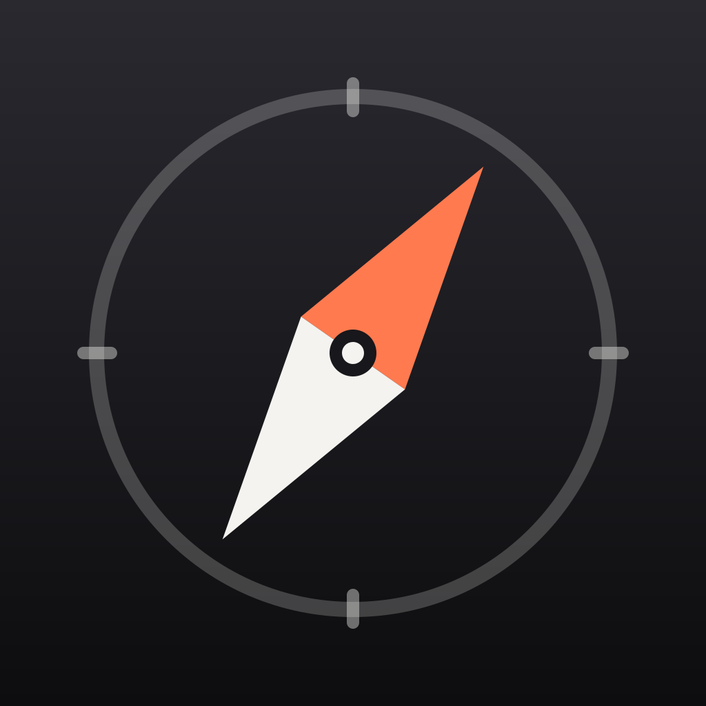
</p>

<h1 align="center">Nomad Pocket</h1>

<p align="center">
  <b>Tu kit de supervivencia sin conexión, en el móvil.</b><br>
  Mapas con navegación, emergencias cercanas, primeros auxilios, Wikipedia y un asistente con IA<br>
  que siguen funcionando cuando internet no: durante días, semanas o meses.<br>
  <sub>Inspirada en <a href="https://github.com/Crosstalk-Solutions/project-nomad">Project N.O.M.A.D.</a> de Crosstalk Solutions.</sub>
</p>

<p align="center">
  
  
  
  
  
</p>

<p align="center">
  <a href="README.md">🇬🇧 Read in English</a>
</p>

<p align="center">
  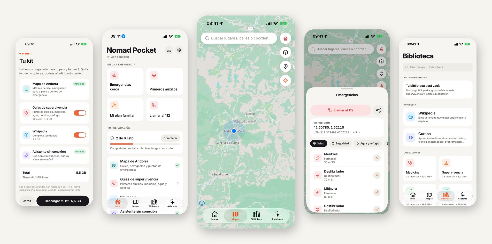
</p>

---

## Por qué

Cuando cae la red, el móvil deja de servir para casi todo. Un apagón como el de España y
Portugal en abril de 2025, una DANA, un terremoto, un conflicto o simplemente estar lejos de
cualquier antena: los mapas no cargan, el buscador no responde y la información que más
necesitas se queda fuera de tu alcance.

Y no solo por la naturaleza. Hoy todo funciona con software, y el software falla a gran
escala: en julio de 2024 una sola actualización defectuosa dejó fuera de servicio millones
de ordenadores en todo el mundo, con vuelos cancelados y hospitales y bancos afectados. Los
ciberataques contra redes eléctricas, operadoras de telecomunicaciones y proveedores en la
nube no paran de crecer, y un ataque masivo a esas infraestructuras podría dejar regiones
enteras sin internet durante días o semanas. Cuanto menos dependamos de la conexión para lo
esencial, más seguros estaremos.

**Nomad Pocket está hecha para ese momento.** La preparas una vez mientras tienes conexión y
tu móvil sigue sabiendo dónde estás, cómo llegar a un sitio, dónde está el hospital o el agua
potable más cercanos, cómo curar una herida y la respuesta a casi cualquier pregunta. Sin
conexión, sin cuenta y sin servidores.

Lleva la idea de [Project N.O.M.A.D.](https://github.com/Crosstalk-Solutions/project-nomad)
(un servidor de conocimiento sin conexión) al dispositivo que todo el mundo lleva encima.

## Lista en un minuto

<table>
  <tr>
    <td align="center" width="33%">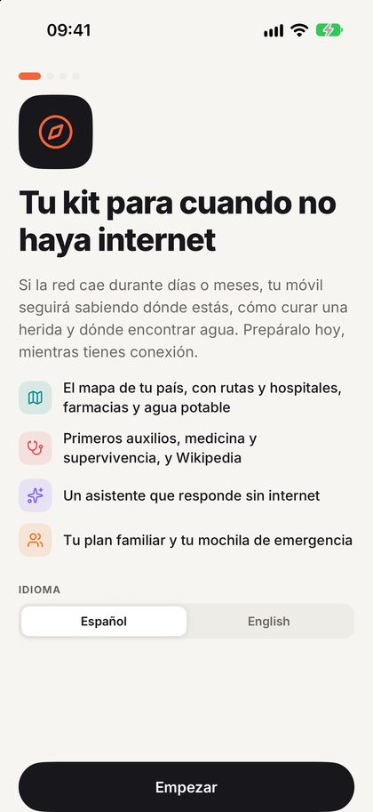</td>
    <td align="center" width="33%">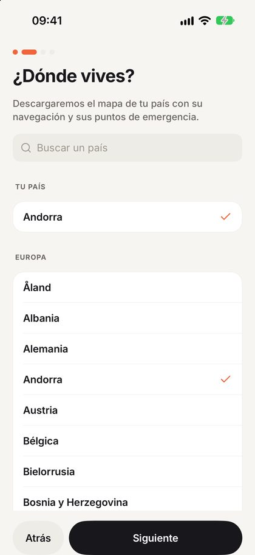</td>
    <td align="center" width="33%">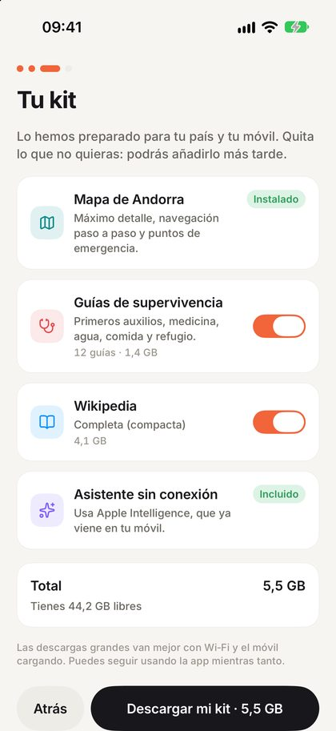</td>
  </tr>
  <tr>
    <td align="center"><b>1. Abre la app</b><br>Idioma detectado, nada que configurar.</td>
    <td align="center"><b>2. Elige tu país</b><br>Ya viene preseleccionado.</td>
    <td align="center"><b>3. Descarga tu kit</b><br>Una propuesta calculada para tu país y tu móvil. Quita lo que no quieras.</td>
  </tr>
</table>

Y ya está. Déjalo con Wi‑Fi mientras descarga; a partir de ahí todo funciona sin conexión.
Inicio te muestra cómo de preparado estás y qué te falta, para que lo completes mientras
aún tengas internet.

## Qué incluye

### 🆘 En una emergencia

- **Emergencias cerca**: hospitales, farmacias, policía, bomberos, agua potable, refugios,
  desfibriladores y más, ordenados por distancia y dirección, y con un toque para que te
  guíe hasta allí. Sin conexión.
- **Llamar al 112 / 911** con un toque y **compartir tu posición** (coordenadas y UTM) por
  mensaje.
- **Primeros auxilios** a un toque desde Inicio.
- **Tu plan familiar**: puntos de encuentro, contactos y los datos médicos de cada uno,
  también en un PDF para imprimir.

<table>
  <tr>
    <td align="center" width="33%">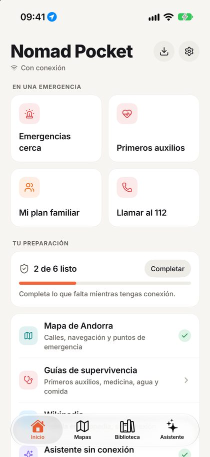</td>
    <td align="center" width="33%">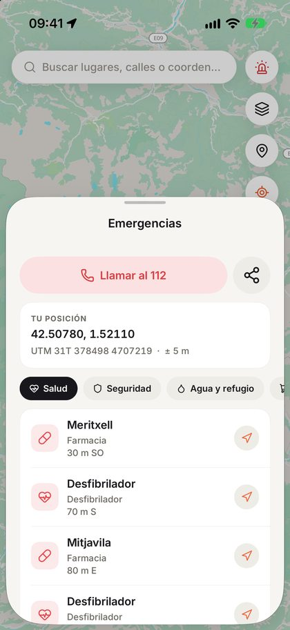</td>
    <td align="center" width="33%">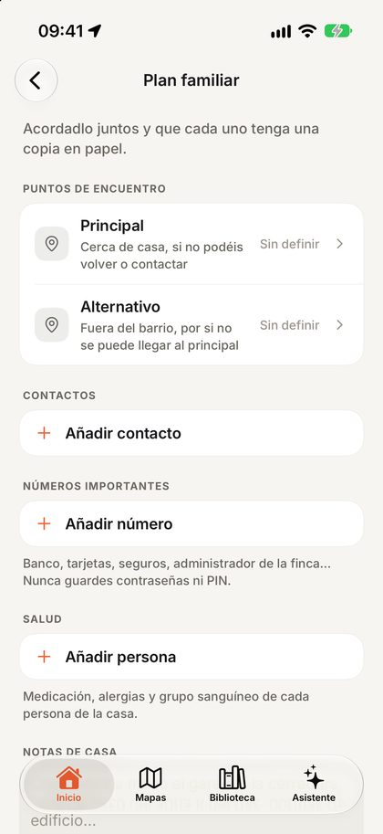</td>
  </tr>
</table>

### 🗺️ Mapas y navegación sin conexión

- **Una descarga por país, con todo dentro**: el mapa con el máximo detalle (todas las
  calles, caminos y edificios), rutas paso a paso en coche, a pie y en bici, los puntos de
  emergencia, y todas las calles, lugares y portales para el buscador (una dirección te lleva
  a la puerta, o junto a ella si OpenStreetMap no tiene ese número).
- **Mapa del mundo incluido en la app**: hay mapa desde el primer segundo.
- Vista de navegación que te sigue, haz de la brújula, lugares guardados, coordenadas y UTM.
- Mapas de todos los países; navegación sin conexión, por ahora, en los 60 países de Europa
  y Latinoamérica, y más en camino.

<table>
  <tr>
    <td align="center" width="50%">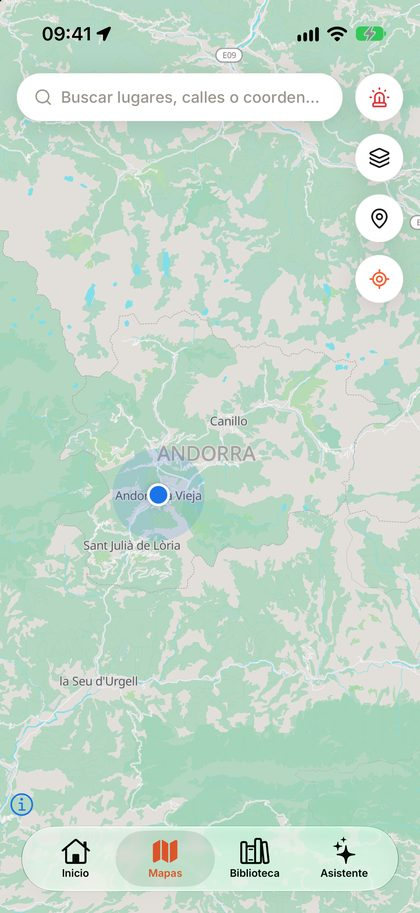</td>
    <td align="center" width="50%">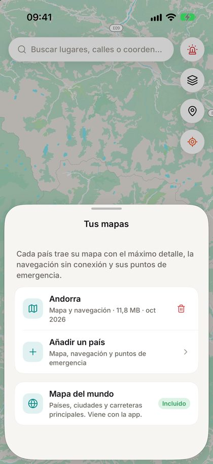</td>
  </tr>
</table>

### 📚 Biblioteca de conocimiento

- **Wikipedia** a la medida de tu espacio: desde los artículos más leídos (~250 MB) hasta la
  enciclopedia completa.
- **Más de 90 colecciones seleccionadas**: medicina y primeros auxilios, supervivencia, agua
  y comida, agricultura, educación, bricolaje y reparaciones, informática. Y miles más del catálogo de
  [Kiwix](https://kiwix.org), o tus propios archivos ZIM.
- Un lector con búsqueda en todo el texto, marcadores, buscar en la página, tamaño de letra
  y modo oscuro.
- **14 cursos** (salud, ciencia, matemáticas, programación…) con tu progreso guardado.

### ✨ Un asistente con IA que funciona en tu móvil

- Usa **Apple Intelligence** si tu iPhone o iPad lo tiene, o descarga un modelo abierto
  (Qwen 3.5, Gemma 4) que funciona en local con llama.cpp. En Android, solo modelos
  descargables.
- **Responde a partir de tu biblioteca, citando las fuentes**, que puedes abrir: "¿cómo
  potabilizo agua?" funciona en mitad de la nada.
- Nada de lo que le preguntas sale del dispositivo.

<table>
  <tr>
    <td align="center" width="50%">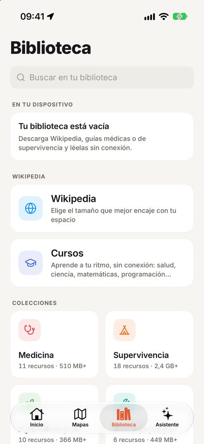</td>
    <td align="center" width="50%">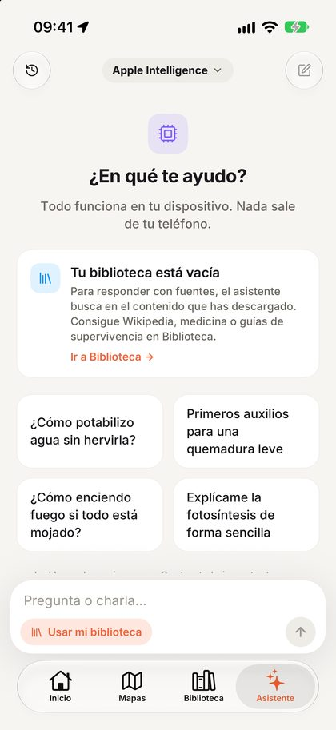</td>
  </tr>
</table>

### 🎒 Prepárate

- **Tu preparación**, en Inicio: mapa, guías, Wikipedia, asistente, plan familiar y mochila de
  emergencia, cada uno con su estado, y un aviso cuando tu mapa se queda antiguo.
- **Mochila de emergencia** calculada para tu hogar (litros de agua, calorías, días), con
  avisos de caducidad.

## Privada por diseño

Sin cuenta. Sin anuncios. Sin analítica. Sin rastreo. Tu plan, tus contactos, tu ubicación y
lo que le preguntas al asistente se quedan en tu móvil. La app no tiene servidor propio:
solo se conecta para descargar el contenido que eliges y para consultar la lista de paquetes
de países disponibles, en servidores públicos (Kiwix y sus espejos, GitHub Releases, Protomaps,
Hugging Face y servidores públicos de Overpass, que solo ven los límites de una región). Las
páginas de los libros que lees no pueden acceder a la red. Al abrir la app con conexión se
consultan los catálogos en GitHub, que ve tu dirección IP.
[Política de privacidad](https://franlindebl.github.io/nomad-pocket/privacy.html).

## Código abierto, datos abiertos

Nomad Pocket es software libre con licencia **GPL-3.0 o posterior**, construido por completo
sobre conocimiento abierto. La GPL cubre el código del proyecto; los datos de abajo conservan
su propia licencia:

| Contenido | Fuente | Licencia |
|---|---|---|
| Mapas, rutas, puntos de emergencia, direcciones | Colaboradores de [OpenStreetMap](https://www.openstreetmap.org), vía [Protomaps](https://protomaps.com) y [Geofabrik](https://www.geofabrik.de) | ODbL |
| Wikipedia y la biblioteca | [Wikipedia](https://www.wikipedia.org) y otros, empaquetados por [Kiwix](https://kiwix.org) | CC BY-SA y otras |
| Motor de rutas | [Valhalla](https://github.com/valhalla/valhalla) | MIT |
| Contornos de países | [Natural Earth](https://www.naturalearthdata.com) | Dominio público |
| IA local | [llama.cpp](https://github.com/ggml-org/llama.cpp), Qwen, Gemma | MIT, Apache-2.0 |
| Motor de lectura | [libkiwix](https://github.com/kiwix/libkiwix), [libzim](https://github.com/openzim/libzim), [Xapian](https://xapian.org), libmicrohttpd | GPL-3.0+, GPL-2.0+, LGPL-2.1+ |

Los paquetes de cada país se construyen a la vista de todos: un
[workflow mensual de GitHub Actions](.github/workflows/country-packages.yml) recorta el mapa
de cada país, construye su grafo de rutas, extrae sus puntos de emergencia, calles, lugares y
portales, y los publica como [GitHub Releases](https://github.com/franlindebl/nomad-pocket/releases).
Cualquiera puede revisarlos o reconstruirlos.

### Colabora

Las ideas, los avisos de fallos y los pull requests son bienvenidos: lee antes
[CONTRIBUTING.md](CONTRIBUTING.md) (en inglés: contribuciones bajo GPL-3.0 o posterior, cómo
compilar desde un clon limpio, las comprobaciones). Problemas de seguridad:
[SECURITY.md](SECURITY.md). Buenos sitios para empezar:

- **Pruébala en tu móvil** (compílala desde el código, abajo) y
  [abre un issue](https://github.com/franlindebl/nomad-pocket/issues) con lo que falló o te
  confundió.
- **Traducciones**: la app habla español e inglés (`src/i18n/locales`).
- **Contenido**: propón colecciones para el catálogo (`src/data/catalog.json`).
- **Países**: ayuda a llevar la navegación sin conexión a más sitios (`scripts/routing/packs.json`).

## Estado

Este README describe la versión **1.1.0** (descargas por país y rediseño de kit de
supervivencia), en beta en TestFlight solo para los probadores del autor. La versión en
revisión en la App Store es la anterior, 1.0.1, sin ello; hasta que salga la 1.1.0, compila
desde el código para probar lo descrito aquí. Google Play llegará pronto. Avance, pendientes
y limitaciones conocidas: [docs/PROGRESS.md](docs/PROGRESS.md).

## Para desarrolladores

Expo SDK 58 · React Native 0.88 (New Architecture) · TypeScript · Expo Router · módulos
nativos para libkiwix (ZIM), Valhalla (rutas) y Apple Foundation Models ·
MapLibre con PMTiles · llama.rn · SQLite.

```bash
npm install            # también descarga los frameworks de libkiwix y Valhalla para iOS
npx expo run:ios       # o: npx expo run:android  (build de desarrollo; Expo Go no sirve)
npm test               # tests unitarios
npx tsc --noEmit && npx expo lint && npm run check:i18n
npm run e2e:setup      # una vez: requisitos de la suite de Maestro
npm run e2e            # suite funcional de Maestro en el simulador de iOS
```

Necesita Node 22.6+, Xcode (27+ para el simulador de iOS 27 que usan Apple Intelligence y la
suite E2E; las compilaciones normales pueden funcionar con Xcode 26) y Android Studio. No hace
falta ninguna cuenta para compilar en simulador o emulador. Documentación (en inglés):
[Desarrollo](docs/DEVELOPMENT.md) · [Arquitectura](docs/ARCHITECTURE.md) ·
[Guía de estilo](docs/STYLE_GUIDE.md) · [Tests E2E](docs/E2E.md) · [Publicación](docs/RELEASE.md) ·
[Plan del rediseño](docs/UX_SURVIVAL_PLAN.md) · [Contribuir](CONTRIBUTING.md) · [Seguridad](SECURITY.md) · [Guía para agentes](CLAUDE.md)

## Aviso

Nomad Pocket es una herramienta de preparación, no sustituye a los servicios de emergencia
ni al consejo médico profesional. Los mapas, los puntos de emergencia y las guías vienen de
fuentes abiertas y pueden estar incompletos o desactualizados. En una emergencia, llama
siempre a tu número de emergencias.

## Créditos y licencia

Inspirada en [Project N.O.M.A.D.](https://github.com/Crosstalk-Solutions/project-nomad) de
Crosstalk Solutions. Posible gracias a Kiwix, Wikipedia, OpenStreetMap, Protomaps, MapLibre,
Valhalla y llama.cpp.

Copyright (C) 2026 Fran Linde Blázquez y colaboradores. GPL-3.0 o posterior: consulta
[LICENSE](LICENSE). Cada biblioteca, fuente y conjunto de datos incluido, con su versión,
copyright y texto de licencia, está en la app, en **Ajustes › Créditos y licencias** (generado
con `node scripts/licenses.mjs`). Datos de mapas © colaboradores de OpenStreetMap (ODbL); los
archivos de `e2e/fixtures` son datos de prueba de terceros, ver
[e2e/fixtures/README.md](e2e/fixtures/README.md).
