<p align="center">
  
</p>

<h1 align="center">Nomad Pocket</h1>

<p align="center">
  <b>Navegador GPS y guías de supervivencia en tu móvil, aunque haya un apagón.</b><br>
  Prepáralo hoy mientras tienes conexión; mañana funciona sin internet, sin cobertura y sin luz.<br>
  Navegación en CarPlay, hospitales cercanos, una guía de emergencia, Wikipedia, cursos y una IA que vive en tu teléfono. Gratis y de código abierto.<br>
  <sub>Inspirada en <a href="https://github.com/Crosstalk-Solutions/project-nomad">Project N.O.M.A.D.</a> de Crosstalk Solutions.</sub>
</p>

<p align="center">
  <a href="https://apps.apple.com/app/nomad-pocket-kit-offline/id6826502392"></a><br>
  <sub>Android · Google Play: muy pronto</sub>
</p>

<p align="center">
  
  
  
  
  
  
</p>

<p align="center">
  <a href="https://nomad-pocket.app/">nomad-pocket.app</a> · <a href="README.md">🇬🇧 Read in English</a>
</p>

<p align="center">
  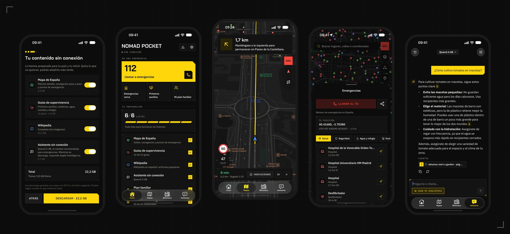
</p>

---

## ¿Y si mañana se cae internet?

El 28 de abril de 2025, España y Portugal se quedaron sin luz durante horas. Las antenas de
telefonía aguantaron lo que duraron sus baterías y muchos móviles se quedaron sin datos ni
cobertura: sin mapas, sin buscador, sin forma de consultar qué hacer. Basta un apagón, un
ciberataque, una tormenta o un fallo informático masivo (en julio de 2024 una sola
actualización defectuosa tumbó millones de ordenadores en todo el mundo) para que tu móvil
enmudezca justo cuando más lo necesitas.

**Nomad Pocket guarda lo esencial en el propio teléfono**, para que siga funcionando cuando
todo lo demás falla:

- **Apagón**: sin luz, las antenas aguantan poco. Tus mapas, guías y plan siguen en tu móvil.
- **Caída de internet o ciberataque**: falla tu operador o un gran servicio en la nube. Nada de lo que llevas depende de ellos.
- **Tormenta o inundación**: cuando el temporal tumba la red, sabes dónde está el refugio, el agua o el hospital.
- **Sin cobertura**: montaña, mar, una carretera perdida: rutas y respuestas sin una sola raya.
- **De viaje**: en el extranjero sin roaming ni SIM local, con el mapa y los números de emergencia del país.

Sin conexión, sin cuenta, sin servidores. Lleva la idea de
[Project N.O.M.A.D.](https://github.com/Crosstalk-Solutions/project-nomad) (un servidor de
conocimiento sin conexión) al dispositivo que todos llevamos encima.

## Listo en un minuto

<table>
  <tr>
    <td align="center" width="40%">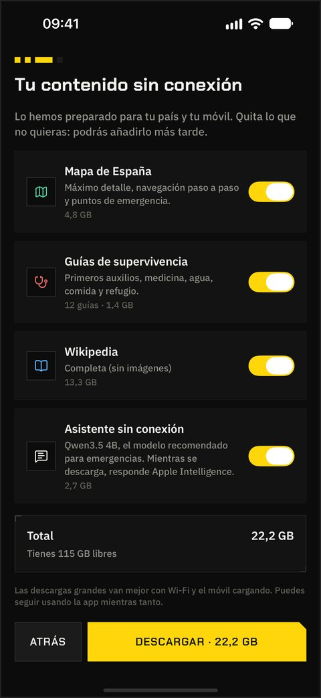</td>
    <td>
      <b>1. Elige tu país.</b> La app te propone un kit a la medida de tu país y del espacio de tu
      teléfono: mapa y rutas, guías, Wikipedia y asistente. Desactiva lo que no quieras.<br><br>
      <b>2. Descárgalo con wifi.</b> Déjalo descargando. Inicio te dice lo preparado que estás y lo
      que falta, para completarlo mientras aún hay red.<br><br>
      <b>3. Úsalo sin conexión.</b> En modo avión, en un apagón o en mitad del monte. Cuando haya
      versiones nuevas de tus mapas o archivos, te avisa.
    </td>
  </tr>
</table>

## Qué llevas dentro

**200+** fichas de emergencia · **100+** archivos de conocimiento · **14** cursos · **0 €**, sin compras ni anuncios

### 🆘 Emergencias

- **El número de emergencias de tu país** en un botón grande en Inicio, y un botón SOS en el mapa.
- **Emergencias cerca**: hospitales, farmacias, desfibriladores, policía, bomberos, agua
  potable y refugios, ordenados por distancia y dirección. Un toque y te lleva hasta allí.
- **Comparte tu posición exacta** por mensaje (coordenadas y UTM). El GPS no necesita datos:
  sabes dónde estás aunque no haya cobertura.
- **Guía de emergencia**: más de 200 fichas de fuentes oficiales (reanimación, hemorragias,
  quemaduras, atragantamiento, incendios, inundaciones…), textos breves pensados para leerse
  con prisa, cada uno con su fuente. En la app desde el primer minuto, sin descargar nada.

<table>
  <tr>
    <td align="center" width="33%">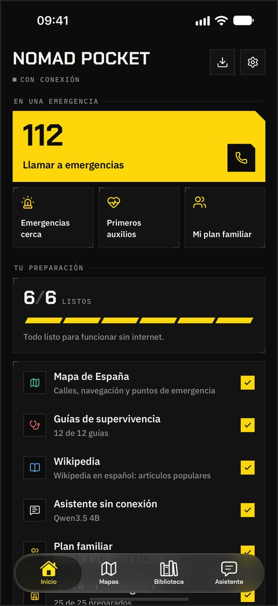</td>
    <td align="center" width="33%">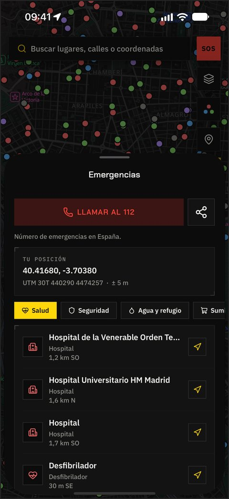</td>
    <td align="center" width="33%">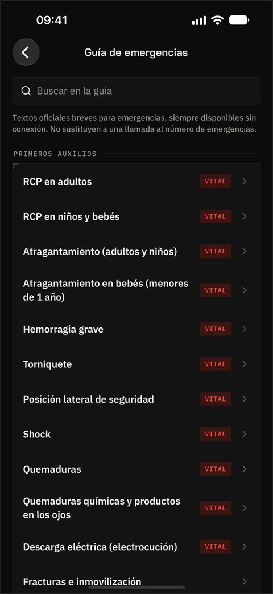</td>
  </tr>
</table>

<sub>Primeros auxilios e información médica: en iPhone y iPad.</sub>

### 🗺️ Mapas y navegación

<table>
  <tr>
    <td align="center" width="40%">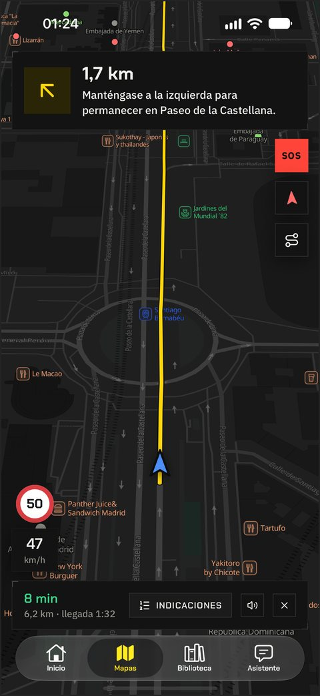</td>
    <td>
      <b>Tu país entero en el móvil</b>: cada calle, camino y edificio, en una sola descarga que
      trae también sus rutas, sus puntos de emergencia y cada calle, lugar y portal para el
      buscador.<br><br>
      <b>Rutas en coche, a pie o en bici</b> sin red, con indicaciones por voz que siguen
      guiándote con la pantalla bloqueada, y aviso del límite de velocidad de cada vía.<br><br>
      Brújula, coordenadas y UTM, lugares guardados. Casi todos los países del mundo, y un mapa
      básico del mundo incluido desde el primer segundo. Canadá, Rusia y Estados Unidos van por
      regiones.
    </td>
  </tr>
</table>

### 🚗 CarPlay

<table>
  <tr>
    <td align="center" width="70%">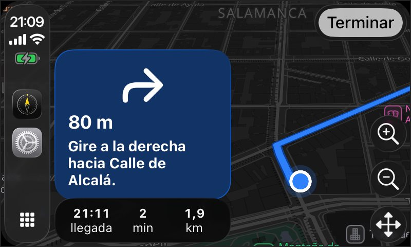</td>
    <td align="center" width="30%">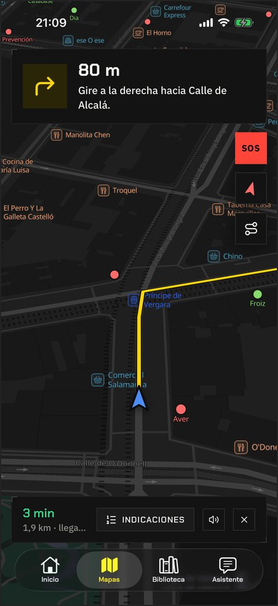</td>
  </tr>
</table>

- **Tu ruta, en la pantalla del coche**: conecta el iPhone y Nomad Pocket aparece en CarPlay con
  el mapa sin conexión y la navegación giro a giro, con indicaciones por voz. También sin
  cobertura, en mitad de la carretera.
- **Desde el coche**: busca un destino, elige un lugar guardado o el hospital, la farmacia o la
  gasolinera más cercanos, mira la distancia y el tiempo del viaje, y en marcha.
- **Móvil y coche a la par**: empieza el viaje en cualquiera de los dos; al terminarlo en uno,
  termina en los dos.

### 📚 Biblioteca y ✨ asistente sin conexión

- **Wikipedia**, a la medida de tu espacio: desde sus artículos esenciales (~250 MB) hasta la
  enciclopedia entera.
- **Más de 100 archivos** de medicina, supervivencia, agua y alimentos, agricultura,
  reparaciones, educación e informática, y miles más del catálogo de [Kiwix](https://kiwix.org),
  o tus propios archivos ZIM.
- Búsqueda de texto completo en todos tus libros, marcadores y lectura en oscuro o en modo
  papel. **14 cursos** con seguimiento del progreso.
- **Una IA que no necesita internet**: pregúntale «¿cómo potabilizo agua?» en mitad de la nada
  y responde con tu biblioteca, con fuentes que puedes abrir. Usa **Apple Intelligence** donde
  está disponible, o un modelo abierto que descargas (Qwen 3.5, Gemma 4) y que funciona en local
  con llama.cpp; en Android, los modelos descargables son la única opción.
- Las preguntas urgentes las responde con la guía de emergencia, incluso sin modelo. Dicta tus
  preguntas: la voz se procesa en el dispositivo. Nada de lo que preguntas sale de tu móvil.

<table>
  <tr>
    <td align="center" width="50%">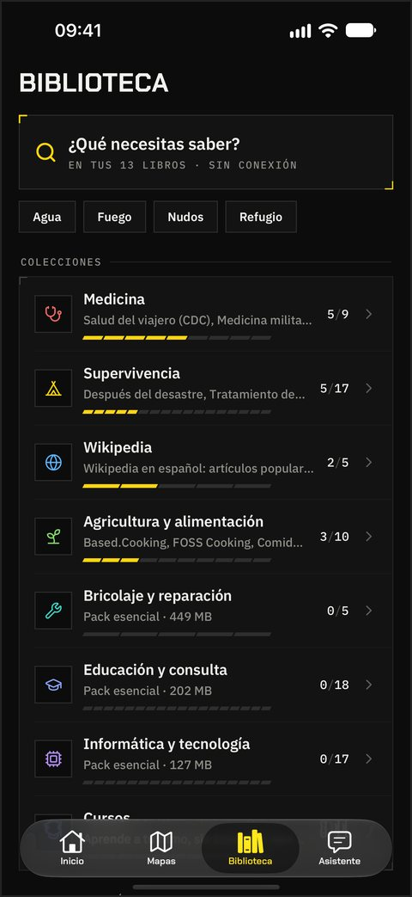</td>
    <td align="center" width="50%">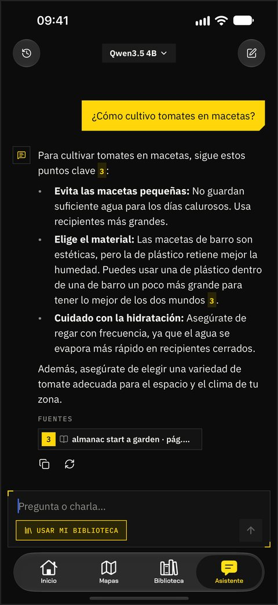</td>
  </tr>
</table>

### 🎒 Plan y mochila

<table>
  <tr>
    <td align="center" width="40%">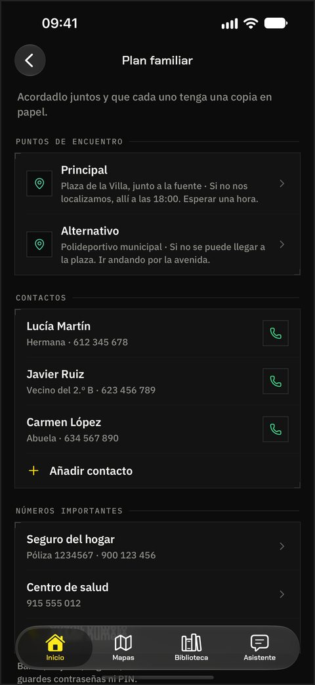</td>
    <td>
      <b>Tu familia sabe qué hacer</b>: puntos de encuentro, contactos y datos de cada uno, también
      en PDF para imprimir. Tu plan no sale del móvil salvo que tú lo compartas.<br><br>
      <b>Una mochila de emergencia a la medida de tu hogar</b>: agua, comida y medicación
      calculadas para tu casa y los días que elijas, con recordatorios locales antes de que algo
      caduque.<br><br>
      <b>Tu preparación</b> en Inicio: mapa, guías, Wikipedia, asistente, plan y mochila, cada uno
      con su estado.
    </td>
  </tr>
</table>

## Privada por diseño

Sin cuenta. Sin anuncios. Sin analítica. Sin rastreo. Tu plan, tus contactos, tu ubicación y
lo que le preguntas al asistente se quedan en tu móvil. La app no tiene servidor propio:
solo se conecta para descargar el contenido que eliges y para consultar la lista de paquetes
de países disponibles, en servidores públicos (Kiwix y sus espejos, GitHub Releases, Protomaps,
Hugging Face y servidores públicos de Overpass, que solo ven los límites de una región). Las
páginas de los libros que lees no pueden acceder a la red. Al abrir la app con conexión se
consultan los catálogos en GitHub, que ve tu dirección IP.
[Política de privacidad](https://nomad-pocket.app/privacy.html).

## Preguntas frecuentes

<details>
<summary><b>¿De verdad funciona sin internet?</b></summary>

Sí. Solo necesitas conexión para descargar el contenido (mejor con wifi) y para buscar
actualizaciones. Después, mapas, rutas, búsqueda de calles, puntos de emergencia, guía,
biblioteca y asistente funcionan en modo avión.
</details>

<details>
<summary><b>¿El GPS funciona sin datos?</b></summary>

Sí. El GPS recibe la señal de los satélites, no de internet, así que el mapa te sitúa aunque
no haya cobertura. La primera posición puede tardar algo más que con datos.
</details>

<details>
<summary><b>¿Cuánto espacio ocupa?</b></summary>

Tú eliges. El asistente de bienvenida propone un kit para tu país y tu espacio libre, y puedes
desactivar cada pieza. El mapa de un país ocupa desde unas decenas de MB hasta varios GB.
</details>

<details>
<summary><b>¿Funciona con CarPlay?</b></summary>

Sí. Al conectar el iPhone al coche, Nomad Pocket aparece en CarPlay con el mapa de tu país:
busca destinos, encuentra emergencias cercanas y te guía por voz, todo sin conexión. Android
Auto todavía no.
</details>

<details>
<summary><b>¿Qué dispositivos son compatibles? ¿Y Android?</b></summary>

iPhone y iPad con iOS 16.4 o posterior, en el App Store. Android 8.0 o posterior llegará a
Google Play con mapas, rutas, emergencias, biblioteca, plan y asistente; los primeros auxilios
y la información médica solo están en iPhone y iPad. El asistente usa Apple Intelligence donde
está disponible; si no, descargas un modelo desde la app (desde unos 500 MB; los más grandes
necesitan más memoria).
</details>

<details>
<summary><b>¿Sustituye a los servicios de emergencia?</b></summary>

No. Te ayuda cuando no hay red, pero la IA puede equivocarse y la información médica no
sustituye a un profesional. Si puedes, llama siempre al número de emergencias.
</details>

## Código abierto, datos abiertos

Nomad Pocket es software libre con licencia **GPL-3.0 o posterior**, construido por completo
sobre conocimiento abierto. La GPL cubre el código del proyecto; los datos de abajo conservan
su propia licencia:

| Contenido | Fuente | Licencia |
|---|---|---|
| Mapas, rutas, puntos de emergencia, direcciones | Colaboradores de [OpenStreetMap](https://www.openstreetmap.org), vía [Protomaps](https://protomaps.com) y [Geofabrik](https://www.geofabrik.de) | ODbL |
| Wikipedia y la biblioteca | [Wikipedia](https://www.wikipedia.org) y otros, empaquetados por [Kiwix](https://kiwix.org) | CC BY-SA y otras |
| Motor de rutas | [Valhalla](https://github.com/valhalla/valhalla) | MIT |
| Contornos de países | [Natural Earth](https://www.naturalearthdata.com) | Dominio público |
| IA local | [llama.cpp](https://github.com/ggml-org/llama.cpp), Qwen, Gemma | MIT, Apache-2.0 |
| Motor de lectura | [libkiwix](https://github.com/kiwix/libkiwix), [libzim](https://github.com/openzim/libzim), [Xapian](https://xapian.org), libmicrohttpd | GPL-3.0+, GPL-2.0+, LGPL-2.1+ |

Los paquetes de cada país se construyen a la vista de todos: un
[workflow mensual de GitHub Actions](.github/workflows/country-packages.yml) recorta el mapa
de cada país, construye su grafo de rutas, extrae sus puntos de emergencia, calles, lugares y
portales, y los publica como [GitHub Releases](https://github.com/franlindebl/nomad-pocket/releases).
Cualquiera puede revisarlos o reconstruirlos.

### Colabora

Las ideas, los avisos de fallos y los pull requests son bienvenidos: lee antes
[CONTRIBUTING.md](CONTRIBUTING.md) (en inglés: contribuciones bajo GPL-3.0 o posterior, cómo
compilar desde un clon limpio, las comprobaciones). Problemas de seguridad:
[SECURITY.md](SECURITY.md). Buenos sitios para empezar:

- **Pruébala en tu móvil** y [abre un issue](https://github.com/franlindebl/nomad-pocket/issues)
  con lo que falló o te confundió.
- **Traducciones**: la app habla español e inglés (`src/i18n/locales`).
- **Contenido**: propón colecciones para el catálogo (`src/data/catalog.json`).
- **Países**: ayuda a llevar la navegación sin conexión a más sitios (`scripts/routing/packs.json`).

## Estado

En el [App Store](https://apps.apple.com/app/nomad-pocket-kit-offline/id6826502392) para iPhone
y iPad, con CarPlay desde la 2.2; Android llegará muy pronto a Google Play. Avance, pendientes y limitaciones conocidas:
[docs/PROGRESS.md](docs/PROGRESS.md).

## Para desarrolladores

Expo SDK 58 · React Native 0.88 (New Architecture) · TypeScript · Expo Router · módulos
nativos para libkiwix (ZIM), Valhalla (rutas) y Apple Foundation Models ·
MapLibre con PMTiles · llama.rn · SQLite.

```bash
npm install            # también descarga los frameworks de libkiwix y Valhalla para iOS
npx expo run:ios       # o: npx expo run:android  (build de desarrollo; Expo Go no sirve)
npm test               # tests unitarios
npx tsc --noEmit && npx expo lint && npm run check:i18n
npm run e2e:setup      # una vez: requisitos de la suite de Maestro
npm run e2e            # suite funcional de Maestro en el simulador de iOS
```

Necesita Node 22.6+, Xcode (27+ para el simulador de iOS 27 que usan Apple Intelligence y la
suite E2E; las compilaciones normales pueden funcionar con Xcode 26) y Android Studio. No hace
falta ninguna cuenta para compilar en simulador o emulador. Las capturas del README se generan
a partir de las capturas de las tiendas con `python3 scripts/site/images.py`. Documentación (en
inglés): [Desarrollo](docs/DEVELOPMENT.md) · [Arquitectura](docs/ARCHITECTURE.md) ·
[Guía de estilo](docs/STYLE_GUIDE.md) · [Tests E2E](docs/E2E.md) · [Publicación](docs/RELEASE.md) ·
[Android y Google Play](docs/ANDROID_PLAY.md) · [Contribuir](CONTRIBUTING.md) · [Seguridad](SECURITY.md) · [Guía para agentes](CLAUDE.md)

## Aviso

Nomad Pocket es una herramienta de preparación, no sustituye a los servicios de emergencia
ni al consejo médico profesional. Los mapas, los puntos de emergencia y las guías vienen de
fuentes abiertas y pueden estar incompletos o desactualizados, y la IA puede equivocarse. En
una emergencia, llama siempre a tu número de emergencias.

## Créditos y licencia

Inspirada en [Project N.O.M.A.D.](https://github.com/Crosstalk-Solutions/project-nomad) de
Crosstalk Solutions. Posible gracias a Kiwix, Wikipedia, OpenStreetMap, Protomaps, MapLibre,
Valhalla y llama.cpp. Nomad Pocket es un proyecto independiente: no está afiliada a Crosstalk
Solutions, Project N.O.M.A.D. ni a ninguno de estos proyectos, ni cuenta con su respaldo.

Copyright (C) 2026 Fran Linde Blázquez y colaboradores. GPL-3.0 o posterior: consulta
[LICENSE](LICENSE). Cada biblioteca, fuente y conjunto de datos incluido, con su versión,
copyright y texto de licencia, está en la app, en **Ajustes › Créditos y licencias** (generado
con `node scripts/licenses.mjs`). Datos de mapas © colaboradores de OpenStreetMap (ODbL); los
archivos de `e2e/fixtures` son datos de prueba de terceros, ver
[e2e/fixtures/README.md](e2e/fixtures/README.md).
Apple, el logotipo de Apple, iPhone, iPad y CarPlay son marcas comerciales de Apple Inc., registradas en
EE. UU. y en otros países. App Store es una marca de servicio de Apple Inc. Google Play es una
marca comercial de Google LLC.
