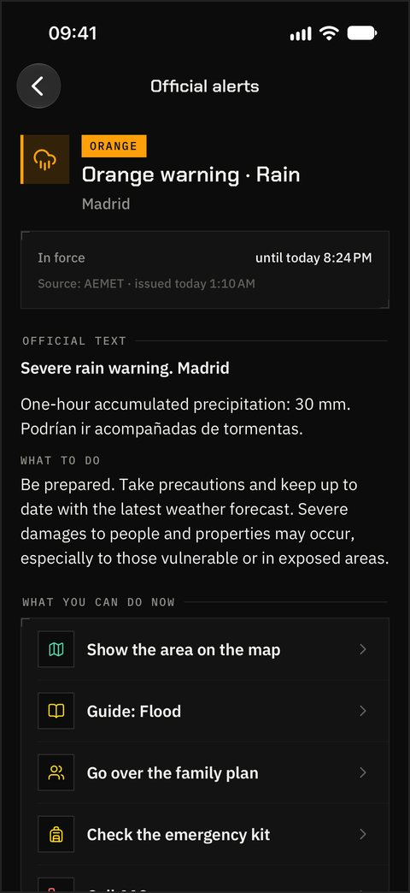
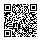
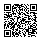

<p align="center">
  
</p>

<h1 align="center">Nomad Pocket</h1>

<p align="center">
  <b>GPS navigation and survival guides on your phone, even in a blackout.</b><br>
  Set it up today while you're online; tomorrow it works with no internet, no signal and no power.<br>
  CarPlay navigation, nearby hospitals, official alerts, an emergency guide, Wikipedia, courses and an AI that lives on your phone. Free and open source.<br>
  <sub>Inspired by <a href="https://github.com/Crosstalk-Solutions/project-nomad">Project N.O.M.A.D.</a> by Crosstalk Solutions.</sub>
</p>

<p align="center">
  <a href="https://apps.apple.com/app/nomad-pocket-kit-offline/id6826502392"></a><br>
  <sub>Android · Google Play: coming soon</sub>
</p>

<p align="center">
  
  
  
  
  
  
</p>

<p align="center">
  <a href="https://nomad-pocket.app/en/">nomad-pocket.app</a> · <a href="README.es.md">🇪🇸 Leer en español</a>
</p>

<p align="center">
  
</p>

---

## What if the internet goes down tomorrow?

On 28 April 2025, Spain and Portugal lost power for hours. Cell towers lasted as long as their
batteries did, and many phones were left with no data and no signal: no maps, no search, no
way to look up what to do. A blackout, a cyberattack, a storm or a massive IT failure (in July
2024 a single faulty update knocked out millions of computers worldwide) is enough to silence
your phone right when you need it most.

**Nomad Pocket keeps the essentials on the phone itself**, so it keeps working when everything
else fails:

- **Blackout**: without power, cell towers don't last long. Your maps, guides and plan stay on your phone.
- **Internet outage or cyberattack**: your carrier or a big cloud service fails. Nothing you carry depends on them.
- **Storm or flood**: while there's still a connection, official alerts tell you what's coming; when the weather takes the network down, you know where the hospital, the pharmacy or the drinking water is.
- **No signal**: mountains, sea, a remote road: routes and answers without a single bar.
- **Travelling**: abroad with no roaming or local SIM, with the local map and the emergency number of the country you're in.

No account, no ads, and nothing you carry needs a connection or a server. It brings the idea of
[Project N.O.M.A.D.](https://github.com/Crosstalk-Solutions/project-nomad) (an offline knowledge
server) to the device everyone already carries.

## Ready in a minute

<table>
  <tr>
    <td align="center" width="40%"></td>
    <td>
      <b>1. Pick your country.</b> The app proposes a kit sized for your country and your phone's
      free space: the map with routes, the essential guides, Wikipedia and the assistant. Switch off
      what you don't want, and choose whether you want official alerts.<br><br>
      <b>2. Download it on Wi‑Fi.</b> Leave it downloading with the app open (on iPhone it also
      carries on in the background). Home tells you how prepared you are and what's missing, so you
      can finish while the network is up.<br><br>
      <b>3. Use it offline.</b> In airplane mode, in a blackout or in the middle of nowhere. When your
      maps, archives or courses have newer versions, it lets you know, and it keeps the old copy
      until the new one is ready.
    </td>
  </tr>
</table>

## What's inside

**200+** emergency cards · **90** knowledge archives · **14** courses · **$0**, no purchases, no ads

### 🆘 Emergency

- **The emergency number of the country you're in** in one big button on Home, and an SOS button
  on the map. The app works out the country from your position, offline (235 countries and
  territories), and where there's no single number it says which one it calls: ambulance or police.
- **Emergency services nearby**: hospitals and health centres, pharmacies, defibrillators, police
  and fire stations, drinking water and springs, shelters and assembly points, fuel stations and
  supermarkets, town halls and embassies. Nearest first, with the distance and direction to each.
  One tap and it takes you there; another calls them when the map has their number.
- **Completed with official data**: in more than 25 countries (Spain, France, Japan, the UK, the
  US, Canada, Australia, Mexico, South Korea…), the pharmacies, hospitals and health centres
  missing from OpenStreetMap are added from official health registers. In Spain, from the
  Ministry of Health and the regions: about 6,800 pharmacies, 7,800 health centres and 120
  hospitals that weren't on the map.
- **Share your exact position** by message: coordinates, UTM, accuracy and a map link. GPS needs
  no data: you know where you are even with no signal.
- **Emergency guide**: 200+ cards (CPR, bleeding, burns, choking, fires, floods, earthquakes…),
  short texts written to be read in a hurry. More than half are official texts, copied or
  faithfully translated (CDC, FEMA, Spain's Protección Civil and Ministry of Health…); we wrote the
  rest following official guidelines (ERC 2025, NHS…), and the card says so. Every card names its
  source and license. In the app from the first minute, nothing to download.

<table>
  <tr>
    <td align="center" width="33%"></td>
    <td align="center" width="33%"></td>
    <td align="center" width="33%"></td>
  </tr>
</table>

<sub>First aid and medical information: on iPhone and iPad. On Android, the guide keeps its other 100+ cards (fires, floods, earthquakes, gas leaks…).</sub>

### 🔔 Official alerts

- **Warnings where you are**: when an official service issues an orange or red warning for your
  area, or there's a strong earthquake nearby, your phone lets you know, so you can get ready while
  there's still a connection. You choose from which level (yellow, orange or red) and whether you
  want earthquakes.
- **Official sources**: AEMET in Spain, the National Weather Service in the US, MeteoAlarm in 35
  European countries (naming the national weather service that issued each warning), GDACS's
  orange and red disaster alerts in the rest of the world, and USGS and EMSC earthquakes everywhere
  (magnitude 4.5 or more within 100 km, or 6 or more within 500 km).
- **As soon as they're published**: a small server of ours checks the sources every minute and
  sends the notification; the app also checks by itself in the background. On iPhone, red
  warnings, tsunamis and the strongest earthquakes arrive as Time Sensitive notifications.
- **What to do**: each alert shows the official text (in your language when the service publishes
  it), who issued it and until when, and takes you to the area on the map, the guide card for that
  hazard, your family plan, your bag and the emergency number. Home shows the warnings in force
  where you are, and you can ask the assistant "any alerts near me?" or whether one crosses your route.
- Off unless you turn them on (the welcome wizard asks). They need a connection to arrive, and
  MeteoAlarm's warnings need notifications and location allowed. Nomad Pocket doesn't issue alerts:
  they're the official services' own and can arrive late or not at all. In an emergency, follow
  your authorities' alerts on your phone and call the emergency number.

<p align="center">
  
</p>

### 🗺️ Maps and navigation

<table>
  <tr>
    <td align="center" width="40%"></td>
    <td>
      <b>Your whole country on your phone</b>: every street, path and building, in one download
      that also carries its routes, emergency points and every street and place for search, with
      house numbers wherever OpenStreetMap has them.<br><br>
      <b>Routes by car, on foot or by bike</b> with no network: spoken directions that keep guiding
      you with the screen locked, a camera that follows the road, the list of turns and a new route
      if you leave it. By car, the road's speed limit where OpenStreetMap has it, and a warning when
      you go over it. With both countries downloaded, one route crosses the border, ferries
      included. Where no road leads, an arrow points the way as the crow flies.<br><br>
      <b>Search with no internet</b>: streets, house numbers, places and categories ("pharmacy"),
      with what's near you first, your recent places, and coordinates in decimal, degrees or UTM.
      Tap any point of the map to see what it is, its address and, when the map has them, its phone
      and whether it's open now.<br><br>
      Compass, coordinates and UTM, saved places, and units that follow your country (km or
      miles). Maps for 241 countries and territories, routes for 233, plus a basic world map built
      in from the first second. The United States, Canada and Russia come by regions.
    </td>
  </tr>
</table>

### 🚗 CarPlay

<table>
  <tr>
    <td align="center" width="70%"></td>
    <td align="center" width="30%"></td>
  </tr>
</table>

- **Your route on your car's screen**: connect your iPhone and Nomad Pocket shows up in CarPlay
  with the offline map and turn-by-turn navigation, spoken directions included. Even with no
  signal, out on the open road.
- **From the car**: search for a destination (or "fuel stations along the route"), pick a saved
  place or the nearest hospital, pharmacy, police station or fuel station, see the trip's length and
  time, and go.
- **Like on the phone**: the same map, the blue arrow and a camera that follows the route smoothly;
  maneuvers with the roundabout exit, distance and arrival time, your speed and the road's speed
  limit sign.
- **Phone and car in step**: start the trip on either one; ending it on one ends it on both.

### 📚 Library

- **Wikipedia** in Spanish or English, sized to your storage: its 50,000 best articles summarized
  (~250 MB) or in full (1.2 GB in Spanish, 2.7 GB in English), up to the whole encyclopedia.
- **80 archives** on survival, water and food, farming, repairs, education, computing and, on
  iPhone and iPad, medicine, grouped in collections with levels (Essential, Standard,
  Comprehensive). The kit downloads each collection's essentials, and nothing downloads twice.
  Plus thousands more from the [Kiwix](https://kiwix.org) catalog in Spanish and English, or your
  own ZIM files.
- **Libraries of PDF guides** (water treatment, knots, food, after a disaster…), searchable inside
  like any other book.
- Full-text search across all your books and their PDFs, contents, find in page, text size,
  bookmarks, and reading in dark or on a paper page. **14 courses** with progress tracking.
- **Pass it on without internet**: send a downloaded archive to another phone (AirDrop, Quick
  Share, Files) and add it there with "Import a ZIM file", also from an SD card.

### ✨ Offline assistant

- **An AI that doesn't need the internet**: ask "how do I make water safe to drink?" in the middle
  of nowhere and it answers from your library, with sources you can open. It searches your archives
  (including their PDF guides, cited by page), the emergency guide and your family plan ("where do
  we meet?"). If it finds nothing, it says so instead of answering from memory.
- **Ask it about the map**: "where's the nearest pharmacy?", "take me to the hospital", "where am
  I?" (with what to say when you call the emergency number, and an SMS ready to send), "can I get
  there before dark?", "fuel stations on the way to Valencia" or "any alerts near me?". It answers
  with cards built from your offline maps: names, distances, times and phone numbers come from the
  data, never from the AI. It works even with no model.
- **Open models that run on your phone** with llama.cpp: Qwen3.5 (0.8B, 2B or 4B) or Gemma 4 E2B,
  from 533 MB to 3.1 GB; the app recommends the one your phone's memory can run. On iPhone and iPad
  with Apple Intelligence (iOS 26 or later) it can also use Apple's built-in model with no
  download, though the recommended model answers better. On Android, downloadable models are the
  only option.
- Urgent questions (CPR, choking, a fire, a gas leak…) get the emergency guide's card word for
  word, not an AI rewrite, even with no model; on Android it doesn't answer health questions and
  gives you the emergency number instead. Dictate your questions: your voice is processed on the
  device (on Android, from Android 13). Conversations are saved on the phone, and nothing you ask
  ever leaves it.

<table>
  <tr>
    <td align="center" width="50%"></td>
    <td align="center" width="50%"></td>
  </tr>
</table>

### 🎒 Plan and bag

<table>
  <tr>
    <td align="center" width="40%"></td>
    <td>
      <b>Your family knows what to do</b>: a main and a backup meeting point on the map, contacts
      with a call button, important numbers, each person's medication, allergies and blood type (on
      iPhone and iPad) and home notes (where the gas valve is). Also as a printable PDF. Your plan
      only leaves your phone if you share it, or inside your system backups.<br><br>
      <b>An emergency bag sized to your household</b>: adults, children and pets, for 72 hours, one
      week or two. Water (4 litres per person per day), food and at least 30 days of medication
      worked out for you, a checklist you can add to, and a local reminder before anything
      expires.<br><br>
      <b>Your preparation</b> on Home: map, guides, Wikipedia, assistant, plan and bag, each with
      its status, plus a card when there are official alerts where you are or your data is months
      old and has a newer version.
    </td>
  </tr>
</table>

## Private by design

No account. No ads. No analytics. No tracking. Your plan, your contacts and your questions to the
assistant stay on your phone, and so does your location unless you share it or turn on official
alerts. Maps, guides, library and assistant work without any server. The app goes online to
download the content you choose from public servers (Kiwix and its mirrors, GitHub Releases and
Hugging Face; Protomaps and public Overpass servers only for the rare map that isn't prebuilt, and
Overpass only sees a region's bounds), and to look for updates: when it opens online it checks
GitHub for the country catalogs, so GitHub sees your IP address, and once a week it asks Kiwix for
newer versions of your archives, sending only their names. Searches in "Explore" go to Kiwix. Pages
of the books you read can't reach the network.

**With official alerts on** (opt-in), the phone downloads the warnings of AEMET, GDACS, USGS and
EMSC, which get no location, and in the US asks the National Weather Service for its area's
warnings with a position rounded to about 5 km. It also registers with our small alerts server
(`server/alerts`, on Firebase in the EU) so warnings arrive at once: the server keeps the push
token, the ~10 km grid square you're in (never your position), your country, language, time zone
and alert settings, and deletes them when you turn alerts off or after 90 days without a renewal.
On Android the push token comes from the phone's Google Play services and Firebase Installations;
the app includes no Google library. [Privacy policy](https://nomad-pocket.app/privacy.html).

## FAQ

<details>
<summary><b>Does it really work without internet?</b></summary>

Yes. You only need a connection to download the content (Wi‑Fi is best) and to check for
updates. After that, maps, routes, street search, emergency points, the guide, the library and
the assistant all work in airplane mode. Only official alerts need a connection to arrive.
</details>

<details>
<summary><b>Does GPS work without data?</b></summary>

Yes. GPS receives signals from satellites, not from the internet, so the map finds you even
with no signal. The first fix may take a little longer than with data.
</details>

<details>
<summary><b>Does it warn me about storms or earthquakes?</b></summary>

Yes, if you turn on official alerts. It shows the warnings published by AEMET (Spain), the US
National Weather Service, MeteoAlarm (35 European countries) and GDACS elsewhere, plus USGS and
EMSC earthquakes, and notifies you of the orange and red ones for your area as soon as they're
published. Alerts need a connection to arrive. Nomad Pocket doesn't issue alerts: in an
emergency, follow your authorities' alerts on your phone and call the emergency number.
</details>

<details>
<summary><b>How much space does it take?</b></summary>

You decide. The welcome wizard suggests a kit for your country and free space, and you can
switch off each piece. A country takes from under 1 MB (a small island) to about 11 GB
(Germany); Spain is about 4.7 GB. The United States, Canada and Russia go by regions, the biggest
about 12 GB. The app shows the exact size before you download.
</details>

<details>
<summary><b>Does it work in my country?</b></summary>

There are maps for 241 countries and territories, and routes, street search and emergency points
for 233; a world map is built in from the first second. In more than 25 countries, pharmacies,
hospitals and health centres are completed with official registers. The app and its library are
in Spanish and English (your own ZIM files can be in any language). Map labels in a few scripts
(Bengali, Tamil, Burmese, Khmer…) aren't drawn yet; search and lists do show them.
</details>

<details>
<summary><b>Does it work with CarPlay?</b></summary>

Yes. Connect your iPhone to the car and Nomad Pocket shows up in CarPlay with your country's
map: search for destinations, find emergency services nearby and get spoken directions, all
offline. Android Auto isn't supported yet.
</details>

<details>
<summary><b>Which devices are supported? What about Android?</b></summary>

iPhone and iPad with iOS 16.4 or later, on the App Store. Android 8.0 or later is in a closed
test on Google Play and opens to everyone once Google approves it, with maps, routes, emergency
services, the library, the plan and the assistant. First aid and medical information are only on
iPhone and iPad, so Android has 103 guide cards, 79 archives and 12 courses. The assistant uses an
open model you download in the app (from 533 MB; larger ones need more memory) or, on iPhones and
iPads that have it, Apple Intelligence.
</details>

<details>
<summary><b>Does it replace the emergency services?</b></summary>

No. It helps when there's no network, but the AI can make mistakes and medical information is
no substitute for a professional. Official alerts don't replace your authorities' alerts on your
phone. If you can, always call the emergency number.
</details>

## Open source, open data

Nomad Pocket is free software under the **GPL-3.0-or-later** license, built entirely on open
knowledge. The GPL covers the project's code; the data below keeps its own license:

| Content | Source | License |
|---|---|---|
| Maps, routes, emergency points, addresses | [OpenStreetMap](https://www.openstreetmap.org) contributors, via [Protomaps](https://protomaps.com) and [Geofabrik](https://www.geofabrik.de) | ODbL |
| More pharmacies, hospitals and health centres | Official health registers of 27 countries: Spain's Ministry of Health and regions, France's FINESS, NHS England, Japan's MHLW and more ([list](docs/OFFICIAL_POINTS.md#covered)) | Each register's own: CC BY 4.0, Licence Ouverte 2.0, OGL, CC0, Spain's Law 37/2007 and others |
| Weather warnings and disasters | [AEMET](https://www.aemet.es) (Spain), [NOAA / National Weather Service](https://www.weather.gov) (US), [EUMETNET – MeteoAlarm](https://meteoalarm.org) (Europe), [GDACS](https://www.gdacs.org) (European Commission JRC, UN OCHA) | © AEMET (reuse terms); public domain; CC BY 4.0 with MeteoAlarm's terms; CC BY 4.0 |
| Earthquakes | [USGS](https://earthquake.usgs.gov), [EMSC-CSEM](https://www.emsc-csem.org) | Public domain; free use with credit |
| Emergency guide | Official texts of US agencies (CDC, FEMA, NIH…) and Spanish public bodies (Protección Civil, Ministry of Health, INSST…), and our own wording | Public domain; Spain's Law 37/2007; GPL-3.0-or-later |
| Emergency numbers | [Wikipedia's list](https://en.wikipedia.org/wiki/List_of_emergency_telephone_numbers), reviewed | CC BY-SA 4.0 |
| Wikipedia and the library | [Wikipedia](https://www.wikipedia.org) and others, packaged by [Kiwix](https://kiwix.org) | CC BY-SA and others |
| Map display | [MapLibre Native](https://github.com/maplibre/maplibre-native), [Protomaps basemaps](https://github.com/protomaps/basemaps), Noto Sans | BSD-2-Clause, BSD-3-Clause and CC0, OFL-1.1 |
| Routing engine | [Valhalla](https://github.com/valhalla/valhalla) | MIT |
| Country outlines | [Natural Earth](https://www.naturalearthdata.com) | Public domain |
| Local AI | [llama.cpp](https://github.com/ggml-org/llama.cpp), Qwen3.5, Gemma 4 | MIT, Apache-2.0 |
| Reading engine | [libkiwix](https://github.com/kiwix/libkiwix), [libzim](https://github.com/openzim/libzim), [Xapian](https://xapian.org), libmicrohttpd | GPL-3.0+, GPL-2.0+, LGPL-2.1+ |

The country packages are built in the open: a monthly
[GitHub Actions workflow](.github/workflows/country-packages.yml) cuts each country's map,
builds its routing graph and border crossings, extracts its emergency points, streets, places and
house numbers, adds the official health registers that
[another monthly workflow](.github/workflows/official-points.yml) downloads, and publishes them as
[GitHub Releases](https://github.com/franlindebl/nomad-pocket/releases). Anyone can audit or
rebuild them.

### Contributing

Ideas, bug reports and pull requests are welcome: read [CONTRIBUTING.md](CONTRIBUTING.md) first
(GPL-3.0-or-later contributions, how to build from a clean clone, the checks to run).
Security problems: [SECURITY.md](SECURITY.md). Good places to start:

- **Try it on your phone** and [open an issue](https://github.com/franlindebl/nomad-pocket/issues)
  with what broke or confused you.
- **Official data for your country**: find your country's open registers of pharmacies, hospitals
  and health centres and add them (`scripts/official/<cc>.py`; what each country publishes:
  [docs/OFFICIAL_POINTS_WORLD.md](docs/OFFICIAL_POINTS_WORLD.md)). The big gaps: India, China,
  Indonesia, Pakistan, Nigeria and Brazil.
- **Translations**: the app speaks Spanish and English. A new language means the interface
  (`src/i18n/locales`), the catalog texts (`src/data/catalog.json`), the system strings
  (`locales/`) and the emergency guide's cards (`src/data/guide/`).
- **Content**: suggest collections for the catalog (`src/data/catalog.json`).

### Support the project

Nomad Pocket is free, with no ads, no purchases and no investors, and it will stay that way. If you
find it useful and can afford it, a donation helps cover what it costs (Apple's and Google's
developer accounts, the alerts server) and the hours behind it. If you can't, recommending it to
someone helps too.

- **Bitcoin**: `bc1qnf8wfuuy4t4pjr0jhpa3dln2t94farapsazeaj`
- **Ethereum**, ETH or USDC on the Ethereum network: `0x34fb22461bC015d8cA09952Fff3BBa09ADD46120`

| Bitcoin | Ethereum |
|:---:|:---:|
|  |  |


The addresses are public: the total is worked out from them every hour and shown on the
[website](https://nomad-pocket.app/en/#donate). The only valid ones are those in this repository
and on nomad-pocket.app.

## Status

On the [App Store](https://apps.apple.com/app/nomad-pocket-kit-offline/id6826502392) for iPhone
and iPad, with CarPlay since 2.2 and official alerts since 2.4 (instant, with MeteoAlarm, from
2.5). Android is in a closed test on Google Play and opens to everyone once Google approves it.
Progress, backlog and known limits: [docs/PROGRESS.md](docs/PROGRESS.md).

## For developers

Expo SDK 58 · React Native 0.88 (New Architecture) · TypeScript · Expo Router · MapLibre with
PMTiles · llama.rn · SQLite. Eight local native modules (`modules/`): libkiwix/libzim, Valhalla
routing, Apple Foundation Models (iOS), CarPlay, spoken directions, streaming file checks, and
location and push without Google Play services code (Android). The optional alerts push server is
in `server/alerts` (Cloud Functions for Firebase + Firestore); it bundles the app's alert logic and
texts and deploys from `main`. The landing page is generated from `scripts/site/build.mjs`.

```bash
npm install            # also fetches the libkiwix and Valhalla iOS frameworks
npx expo run:ios       # or: npx expo run:android  (dev build; Expo Go won't work)
npm test               # unit tests
npx tsc --noEmit && npx expo lint && npm run check:i18n
npm run e2e:setup      # once: Maestro suite prerequisites
npm run e2e            # Maestro functional suite on the iOS simulator
cd server/alerts && npm run check   # alerts server, after touching it or the app's alert code
node scripts/site/build.mjs         # regenerates the landing page (site/)
```

Requires Node 22.13+ or 24.3+ (Expo SDK 58's minimum), Xcode (27+ for the iOS 27 simulator
runtime that Apple Intelligence and the E2E suite need; plain builds may work on Xcode 26) and
Android Studio. No accounts are needed for simulator and emulator builds. The README's screenshots
are generated from the store captures by `python3 scripts/site/images.py`. Docs:
[Development](docs/DEVELOPMENT.md) · [Architecture](docs/ARCHITECTURE.md) ·
[Style guide](docs/STYLE_GUIDE.md) · [E2E tests](docs/E2E.md) · [Release](docs/RELEASE.md) ·
[Android and Google Play](docs/ANDROID_PLAY.md) · [Contributing](CONTRIBUTING.md) · [Security](SECURITY.md) · [Agent guide](CLAUDE.md)

## Disclaimer

Nomad Pocket is a preparedness tool, not a replacement for emergency services or
professional medical advice. Map data, emergency points and guides come from open sources
and can be incomplete or out of date, and the AI can make mistakes. Official alerts are the
ones official services publish: Nomad Pocket doesn't issue alerts, and they can arrive late or
not at all. In an emergency, follow your authorities' alerts on your phone and always call your
local emergency number.

## Credits and license

Inspired by [Project N.O.M.A.D.](https://github.com/Crosstalk-Solutions/project-nomad) by
Crosstalk Solutions. Made possible by Kiwix, Wikipedia, OpenStreetMap, Protomaps, MapLibre,
Valhalla, llama.cpp, the official health registers of each country, and the alerts of AEMET,
MeteoAlarm, the NWS, USGS, EMSC and GDACS. Nomad Pocket is an independent project: it is not
affiliated with or endorsed by Crosstalk Solutions, Project N.O.M.A.D. or any of these projects
or bodies.

Copyright (C) 2026 Fran Linde Blázquez and contributors. GPL-3.0-or-later: see
[LICENSE](LICENSE). Every bundled library, font and data set with its version, copyright and
license text is listed in the app under **Settings › Credits & licenses** (generated by
`node scripts/licenses.mjs`). Map data © OpenStreetMap contributors (ODbL); the files in
`e2e/fixtures` are third-party test data, see [e2e/fixtures/README.md](e2e/fixtures/README.md).
Apple, the Apple logo, iPhone, iPad and CarPlay are trademarks of Apple Inc., registered in the U.S. and
other countries. App Store is a service mark of Apple Inc. Google Play is a trademark of Google LLC.
