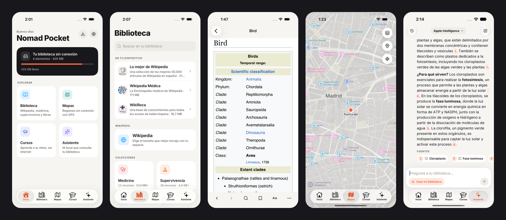

# Nomad Pocket

**Knowledge that never goes offline — in your pocket.**
*El conocimiento que nunca se desconecta, en tu bolsillo.*

Nomad Pocket is an open-source iOS and Android app that brings the idea of
[Project N.O.M.A.D.](https://github.com/Crosstalk-Solutions/project-nomad) to mobile:
download what matters while you have a connection, then use it anywhere, with no
internet at all.

- 📚 **Library** — Wikipedia, medical references, survival and DIY guides, books (Kiwix ZIM files)
- 🗺️ **Offline maps** — cut any region from the OpenStreetMap/Protomaps planet, GPS and pins
- 🎓 **Courses** — educational content with progress tracking
- ✨ **Local AI assistant** — on-device model that answers from your library, with sources
- 🌍 Spanish and English, light and dark themes



## Status

All four MVP modules work end to end on the iOS simulator and the Android emulator
(Release builds): catalog + downloads (pause/resume, background on iOS), ZIM reader
with full-text search, on-device map extraction + offline rendering, courses with
progress, and the local assistant (Apple Intelligence or llama.cpp GGUF models)
answering from your library with citations. See [docs/PROGRESS.md](docs/PROGRESS.md).

## Development

```bash
npm install            # also fetches the libkiwix iOS xcframework (postinstall)
npx expo run:ios       # or: npx expo run:android
npm test               # unit tests (pmtiles, OPDS, RAG, HTML, markdown…)
node scripts/validate-catalog.mjs   # checks every catalog download URL
```

Building iOS from the command line: pass `-packageAuthorizationProvider netrc` to
`xcodebuild`, otherwise SwiftPM can block on a Keychain prompt.

Requires Xcode 26+ and Android SDK/NDK. Native code lives in `modules/` (local Expo
modules); `ios/` and `android/` are generated by `expo prebuild`.

Docs: [Architecture](docs/ARCHITECTURE.md) · [Style guide](docs/STYLE_GUIDE.md) · [Progress](docs/PROGRESS.md)

## Credits

Inspired by Project N.O.M.A.D. by Crosstalk Solutions (Apache-2.0). Content and
libraries from [Kiwix](https://kiwix.org) (libkiwix/libzim, GPL), Wikipedia,
[OpenStreetMap](https://openstreetmap.org) contributors, [Protomaps](https://protomaps.com),
[MapLibre](https://maplibre.org), [llama.cpp](https://github.com/ggml-org/llama.cpp).

## License

GPL-3.0-or-later. See [LICENSE](LICENSE).
