<p align="center">
  
</p>

<h1 align="center">Nomad Pocket</h1>

<p align="center">
  <b>GPS navigation and survival guides on your phone, even in a blackout.</b><br>
  Set it up today while you're online; tomorrow it works with no internet, no signal and no power.<br>
  CarPlay navigation, nearby hospitals, an emergency guide, Wikipedia, courses and an AI that lives on your phone. Free and open source.<br>
  <sub>Inspired by <a href="https://github.com/Crosstalk-Solutions/project-nomad">Project N.O.M.A.D.</a> by Crosstalk Solutions.</sub>
</p>

<p align="center">
  <a href="https://apps.apple.com/app/nomad-pocket-kit-offline/id6826502392"></a><br>
  <sub>Android · Google Play: coming soon</sub>
</p>

<p align="center">
  
  
  
  
  
  
</p>

<p align="center">
  <a href="https://nomad-pocket.app/en/">nomad-pocket.app</a> · <a href="README.es.md">🇪🇸 Leer en español</a>
</p>

<p align="center">
  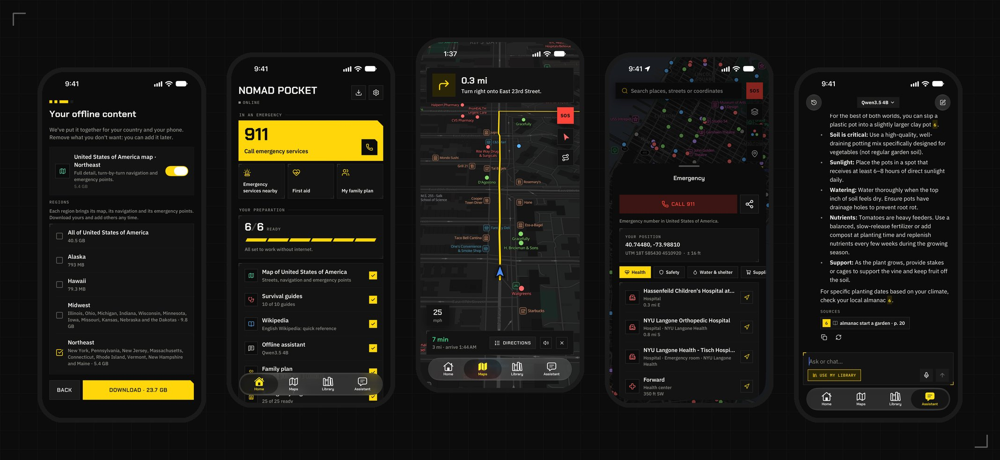
</p>

---

## What if the internet goes down tomorrow?

On 28 April 2025, Spain and Portugal lost power for hours. Cell towers lasted as long as their
batteries did, and many phones were left with no data and no signal: no maps, no search, no
way to look up what to do. A blackout, a cyberattack, a storm or a massive IT failure (in July
2024 a single faulty update knocked out millions of computers worldwide) is enough to silence
your phone right when you need it most.

**Nomad Pocket keeps the essentials on the phone itself**, so it keeps working when everything
else fails:

- **Blackout**: without power, cell towers don't last long. Your maps, guides and plan stay on your phone.
- **Internet outage or cyberattack**: your carrier or a big cloud service fails. Nothing you carry depends on them.
- **Storm or flood**: when the weather takes the network down, you know where the shelter, water or hospital is.
- **No signal**: mountains, sea, a remote road: routes and answers without a single bar.
- **Travelling**: abroad with no roaming or local SIM, with the local map and emergency numbers.

No connection, no account, no servers. It brings the idea of
[Project N.O.M.A.D.](https://github.com/Crosstalk-Solutions/project-nomad) (an offline knowledge
server) to the device everyone already carries.

## Ready in a minute

<table>
  <tr>
    <td align="center" width="40%">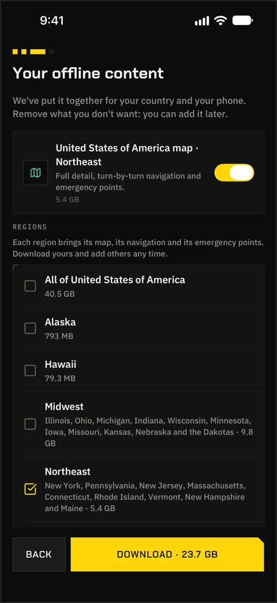</td>
    <td>
      <b>1. Pick your country.</b> The app proposes a kit sized for your country and your phone's
      storage: map and routes, guides, Wikipedia and the assistant. Switch off what you don't want.<br><br>
      <b>2. Download it on Wi‑Fi.</b> Leave it downloading. Home tells you how prepared you are and
      what's missing, so you can finish while the network is up.<br><br>
      <b>3. Use it offline.</b> In airplane mode, in a blackout or in the middle of nowhere. When your
      maps or archives have newer versions, it lets you know.
    </td>
  </tr>
</table>

## What's inside

**200+** emergency cards · **100+** knowledge archives · **14** courses · **$0**, no purchases, no ads

### 🆘 Emergency

- **Your country's emergency number** in one big button on Home, and an SOS button on the map.
- **Emergency services nearby**: hospitals, pharmacies, defibrillators, police, fire stations,
  drinking water and shelters, sorted by distance and direction. One tap and it takes you there.
- **Share your exact position** by message (coordinates and UTM). GPS needs no data: you know
  where you are even with no signal.
- **Emergency guide**: 200+ cards from official sources (CPR, bleeding, burns, choking, fires,
  floods…), short texts written to be read in a hurry, each citing its source. In the app from
  the first minute, nothing to download.

<table>
  <tr>
    <td align="center" width="33%">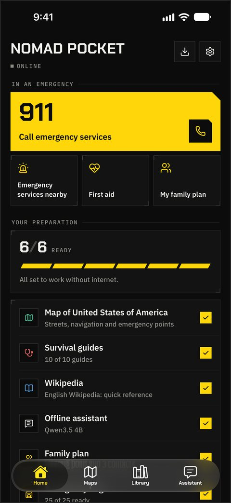</td>
    <td align="center" width="33%">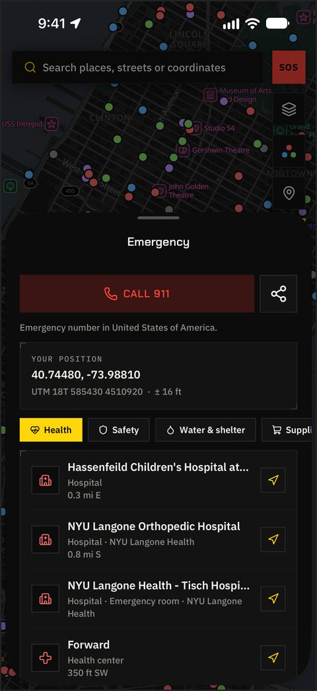</td>
    <td align="center" width="33%">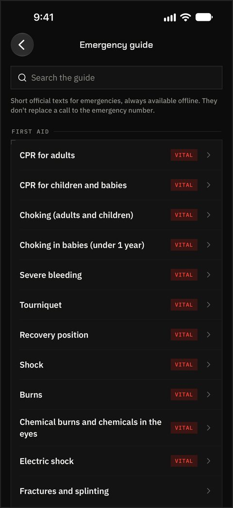</td>
  </tr>
</table>

<sub>First aid and medical information: on iPhone and iPad.</sub>

### 🗺️ Maps and navigation

<table>
  <tr>
    <td align="center" width="40%">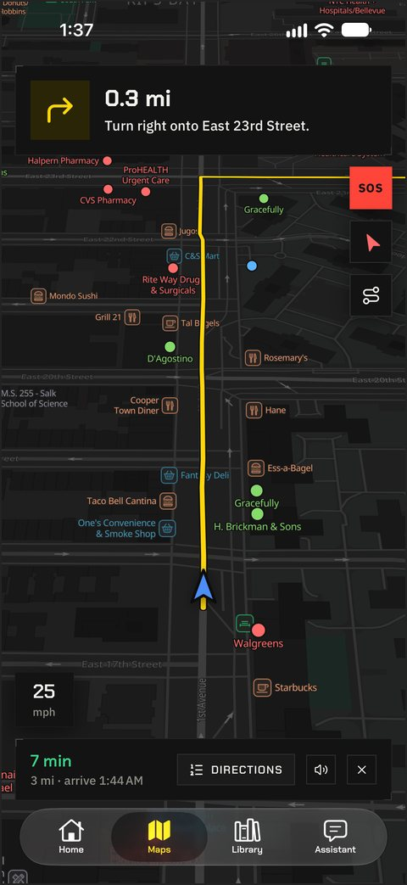</td>
    <td>
      <b>Your whole country on your phone</b>: every street, path and building, in one download
      that also carries its routes, emergency points and every street, place and house number for
      search.<br><br>
      <b>Routes by car, on foot or by bike</b> with no network, with spoken directions that keep
      guiding you with the screen locked, and a warning with each road's speed limit.<br><br>
      Compass, coordinates and UTM, saved places. Almost every country in the world, plus a basic
      world map built in from the first second. Canada, Russia and the United States come by
      regions.
    </td>
  </tr>
</table>

### 🚗 CarPlay

<table>
  <tr>
    <td align="center" width="70%">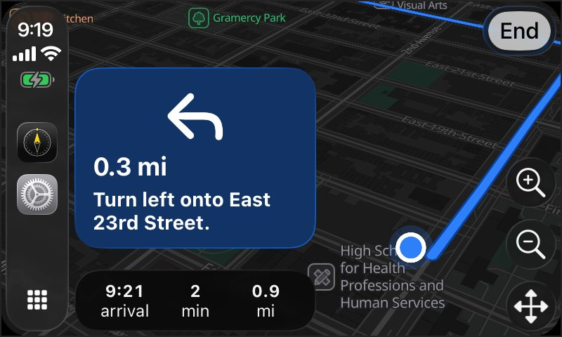</td>
    <td align="center" width="30%">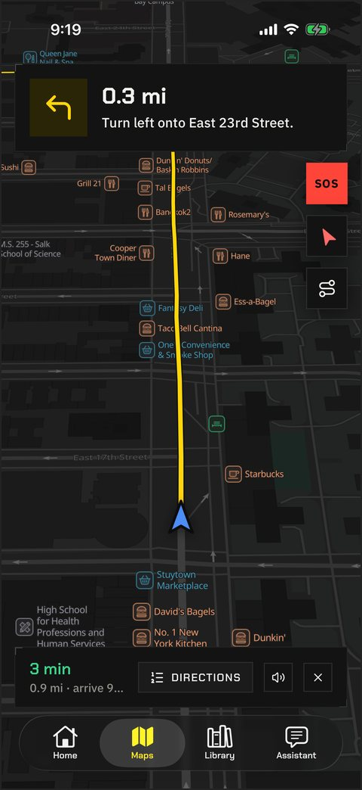</td>
  </tr>
</table>

- **Your route on your car's screen**: connect your iPhone and Nomad Pocket shows up in CarPlay
  with the offline map and turn-by-turn navigation, spoken directions included. Even with no
  signal, out on the open road.
- **From the car**: search for a destination, pick a saved place or the nearest hospital,
  pharmacy or fuel station, see the trip's length and time, and go.
- **Phone and car in step**: start the trip on either one; ending it on one ends it on both.

### 📚 Library and ✨ offline assistant

- **Wikipedia**, sized to your storage: from its essential articles (~250 MB) to the whole
  encyclopedia.
- **100+ archives** on medicine, survival, water and food, farming, repairs, education and
  computing, plus thousands more from the [Kiwix](https://kiwix.org) catalog, or your own ZIM files.
- Full-text search across all your books, bookmarks, and reading in dark or on a paper page.
  **14 courses** with progress tracking.
- **An AI that doesn't need the internet**: ask "how do I make water safe to drink?" in the
  middle of nowhere and it answers from your library, with sources you can open. It uses
  **Apple Intelligence** where available, or an open model you download (Qwen 3.5, Gemma 4)
  that runs locally with llama.cpp; on Android, downloadable models are the only option.
- Urgent questions are answered from the emergency guide, even with no model. Dictate your
  questions: your voice is processed on the device. Nothing you ask ever leaves your phone.

<table>
  <tr>
    <td align="center" width="50%">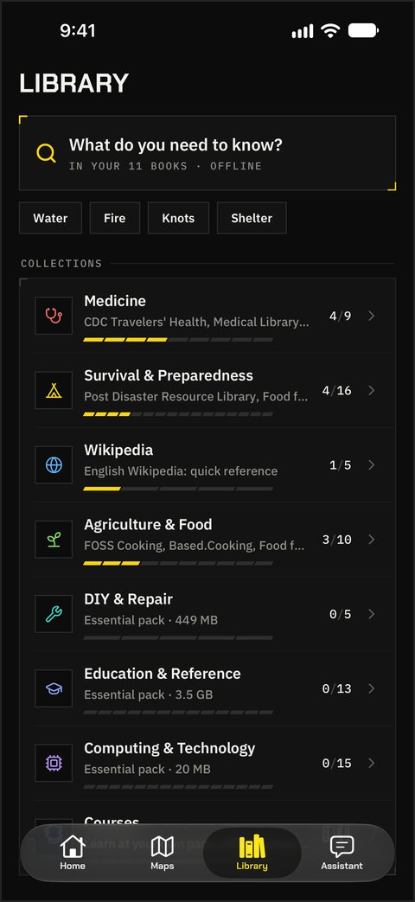</td>
    <td align="center" width="50%">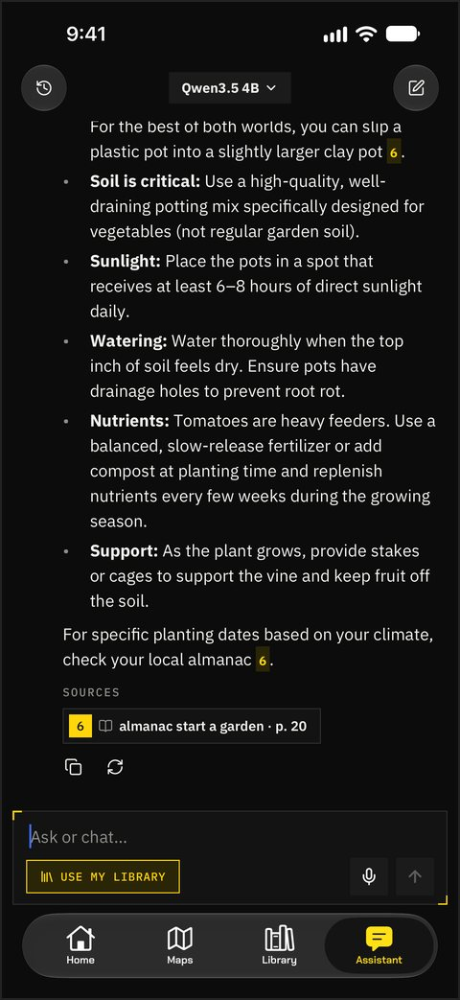</td>
  </tr>
</table>

### 🎒 Plan and bag

<table>
  <tr>
    <td align="center" width="40%">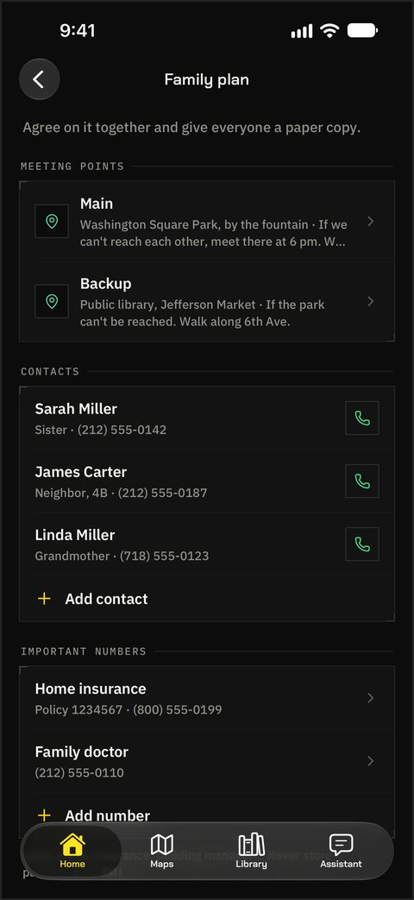</td>
    <td>
      <b>Your family knows what to do</b>: meeting points, contacts and everyone's details, also as
      a printable PDF. Your plan never leaves your phone unless you share it.<br><br>
      <b>An emergency bag sized to your household</b>: water, food and medication worked out for
      your home and the days you choose, with local reminders before anything expires.<br><br>
      <b>Your preparation</b> on Home: map, guides, Wikipedia, assistant, plan and bag, each with
      its status.
    </td>
  </tr>
</table>

## Private by design

No account. No ads. No analytics. No tracking. Your plan, your contacts, your location and
your questions to the assistant stay on your phone. Everything works without a server: the app
only goes online to download the content you choose and to check the list of available country
packages, from public servers (Kiwix and its mirrors, GitHub Releases, Protomaps, Hugging
Face, and public Overpass servers, which only see a region's bounds). Pages of the
books you read can't reach the network. When the app opens online it checks GitHub for the
catalogs, so GitHub sees your IP address. The one exception is opt-in: with official alerts on,
the phone registers its push token and a ~10 km grid square with our small alerts server
(`server/alerts`, Firebase, EU), so warnings arrive at once.
[Privacy policy](https://nomad-pocket.app/privacy.html).

## FAQ

<details>
<summary><b>Does it really work without internet?</b></summary>

Yes. You only need a connection to download the content (Wi‑Fi is best) and to check for
updates. After that, maps, routes, street search, emergency points, the guide, the library and
the assistant all work in airplane mode.
</details>

<details>
<summary><b>Does GPS work without data?</b></summary>

Yes. GPS receives signals from satellites, not from the internet, so the map finds you even
with no signal. The first fix may take a little longer than with data.
</details>

<details>
<summary><b>How much space does it take?</b></summary>

You decide. The welcome wizard suggests a kit for your country and free space and you can
switch off each piece. A country's map takes from a few tens of MB to several GB.
</details>

<details>
<summary><b>Does it work with CarPlay?</b></summary>

Yes. Connect your iPhone to the car and Nomad Pocket shows up in CarPlay with your country's
map: search for destinations, find emergency services nearby and get spoken directions, all
offline. Android Auto isn't supported yet.
</details>

<details>
<summary><b>Which devices are supported? What about Android?</b></summary>

iPhone and iPad with iOS 16.4 or later, on the App Store. Android 8.0 or later is coming to
Google Play, with maps, routes, emergency services, the library, the plan and the assistant;
first aid and medical information are only on iPhone and iPad. The assistant uses Apple
Intelligence where available; otherwise you download a model in the app (from about 500 MB;
larger ones need more memory).
</details>

<details>
<summary><b>Does it replace the emergency services?</b></summary>

No. It helps when there's no network, but the AI can make mistakes and medical information is
no substitute for a professional. If you can, always call the emergency number.
</details>

## Open source, open data

Nomad Pocket is free software under the **GPL-3.0-or-later** license, built entirely on open
knowledge. The GPL covers the project's code; the data below keeps its own license:

| Content | Source | License |
|---|---|---|
| Maps, routes, emergency points, addresses | [OpenStreetMap](https://www.openstreetmap.org) contributors, via [Protomaps](https://protomaps.com) and [Geofabrik](https://www.geofabrik.de) | ODbL |
| Wikipedia and the library | [Wikipedia](https://www.wikipedia.org) and others, packaged by [Kiwix](https://kiwix.org) | CC BY-SA and others |
| Routing engine | [Valhalla](https://github.com/valhalla/valhalla) | MIT |
| Country outlines | [Natural Earth](https://www.naturalearthdata.com) | Public domain |
| Local AI | [llama.cpp](https://github.com/ggml-org/llama.cpp), Qwen, Gemma | MIT, Apache-2.0 |
| Reading engine | [libkiwix](https://github.com/kiwix/libkiwix), [libzim](https://github.com/openzim/libzim), [Xapian](https://xapian.org), libmicrohttpd | GPL-3.0+, GPL-2.0+, LGPL-2.1+ |

The country packages are built in the open: a monthly
[GitHub Actions workflow](.github/workflows/country-packages.yml) cuts each country's map,
builds its routing graph and extracts its emergency points, streets, places and house
numbers, and publishes them as [GitHub Releases](https://github.com/franlindebl/nomad-pocket/releases).
Anyone can audit or rebuild them.

### Contributing

Ideas, bug reports and pull requests are welcome: read [CONTRIBUTING.md](CONTRIBUTING.md) first
(GPL-3.0-or-later contributions, how to build from a clean clone, the checks to run).
Security problems: [SECURITY.md](SECURITY.md). Good places to start:

- **Try it on your phone** and [open an issue](https://github.com/franlindebl/nomad-pocket/issues)
  with what broke or confused you.
- **Translations**: the app speaks Spanish and English (`src/i18n/locales`).
- **Content**: suggest collections for the catalog (`src/data/catalog.json`).
- **Countries**: help bring offline routing to more of the world (`scripts/routing/packs.json`).

## Status

On the [App Store](https://apps.apple.com/app/nomad-pocket-kit-offline/id6826502392) for iPhone
and iPad, with CarPlay since 2.2; Android is coming soon to Google Play. Progress, backlog and known limits:
[docs/PROGRESS.md](docs/PROGRESS.md).

## For developers

Expo SDK 58 · React Native 0.88 (New Architecture) · TypeScript · Expo Router · native
modules for libkiwix (ZIM), Valhalla (routing) and Apple Foundation Models ·
MapLibre with PMTiles · llama.rn · SQLite.

```bash
npm install            # also fetches the libkiwix and Valhalla iOS frameworks
npx expo run:ios       # or: npx expo run:android  (dev build; Expo Go won't work)
npm test               # unit tests
npx tsc --noEmit && npx expo lint && npm run check:i18n
npm run e2e:setup      # once: Maestro suite prerequisites
npm run e2e            # Maestro functional suite on the iOS simulator
```

Requires Node 22.6+, Xcode (27+ for the iOS 27 simulator runtime that Apple Intelligence and
the E2E suite need; plain builds may work on Xcode 26) and Android Studio. No accounts are
needed for simulator and emulator builds. The README's screenshots are generated from the
store captures by `python3 scripts/site/images.py`. Docs:
[Development](docs/DEVELOPMENT.md) · [Architecture](docs/ARCHITECTURE.md) ·
[Style guide](docs/STYLE_GUIDE.md) · [E2E tests](docs/E2E.md) · [Release](docs/RELEASE.md) ·
[Android and Google Play](docs/ANDROID_PLAY.md) · [Contributing](CONTRIBUTING.md) · [Security](SECURITY.md) · [Agent guide](CLAUDE.md)

## Disclaimer

Nomad Pocket is a preparedness tool, not a replacement for emergency services or
professional medical advice. Map data, emergency points and guides come from open sources
and can be incomplete or out of date, and the AI can make mistakes. In an emergency, always
call your local emergency number.

## Credits and license

Inspired by [Project N.O.M.A.D.](https://github.com/Crosstalk-Solutions/project-nomad) by
Crosstalk Solutions. Made possible by Kiwix, Wikipedia, OpenStreetMap, Protomaps, MapLibre,
Valhalla and llama.cpp. Nomad Pocket is an independent project: it is not affiliated with or
endorsed by Crosstalk Solutions, Project N.O.M.A.D. or any of these projects.

Copyright (C) 2026 Fran Linde Blázquez and contributors. GPL-3.0-or-later: see
[LICENSE](LICENSE). Every bundled library, font and data set with its version, copyright and
license text is listed in the app under **Settings › Credits & licenses** (generated by
`node scripts/licenses.mjs`). Map data © OpenStreetMap contributors (ODbL); the files in
`e2e/fixtures` are third-party test data, see [e2e/fixtures/README.md](e2e/fixtures/README.md).
Apple, the Apple logo, iPhone, iPad and CarPlay are trademarks of Apple Inc., registered in the U.S. and
other countries. App Store is a service mark of Apple Inc. Google Play is a trademark of Google LLC.
