<p align="center">
  
</p>

<h1 align="center">Nomad Pocket</h1>

<p align="center">
  <b>The offline survival kit for your phone.</b><br>
  Maps with navigation, emergency services, first aid, Wikipedia and an AI assistant<br>
  that keep working when the internet doesn't — for days, weeks or months.<br>
  <sub>Inspired by <a href="https://github.com/Crosstalk-Solutions/project-nomad">Project N.O.M.A.D.</a> by Crosstalk Solutions.</sub>
</p>

<p align="center">
  
  
  
  
  
</p>

<p align="center">
  <a href="README.es.md">🇪🇸 Leer en español</a>
</p>

<p align="center">
  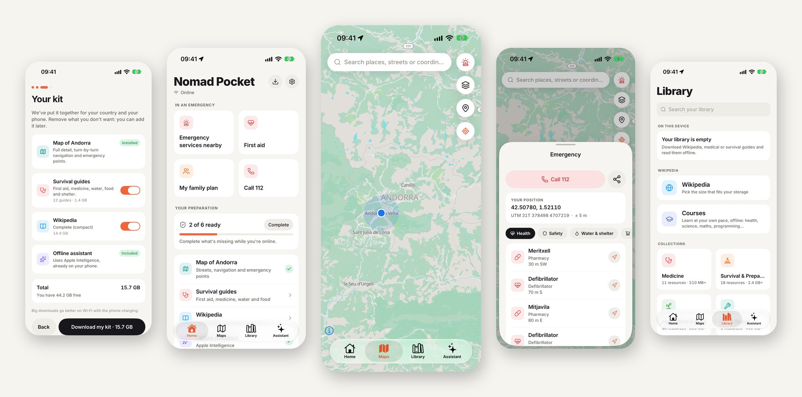
</p>

---

## Why

When the network goes down, most of your phone goes with it. A blackout like the one that
hit Spain and Portugal in April 2025, a storm, an earthquake, a conflict, or simply being far
from any tower: maps stop loading, search stops answering, and the information you need most
is suddenly out of reach.

And not only because of nature. Everything now runs on software, and software fails at
scale: in July 2024 a single faulty update knocked out millions of computers worldwide,
grounding flights and disrupting hospitals and banks. Cyberattacks on power grids, telecom
networks and cloud providers are growing, and a large-scale attack on that infrastructure
could leave whole regions without internet for days or weeks. The less we depend on a
connection for the essentials, the safer we are.

**Nomad Pocket is built for that moment.** Prepare it once while you're online, and your
phone keeps knowing where you are, how to get somewhere, where the nearest hospital or
drinking water is, how to treat a wound, and the answer to almost any question. No
connection, no account, no servers.

It brings the idea of [Project N.O.M.A.D.](https://github.com/Crosstalk-Solutions/project-nomad)
(an offline knowledge server) to the device everyone already carries.

## Ready in a minute

<table>
  <tr>
    <td align="center" width="33%">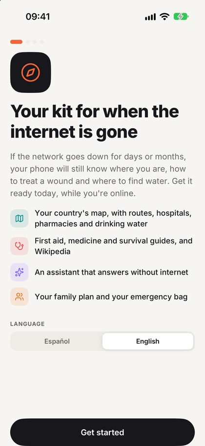</td>
    <td align="center" width="33%">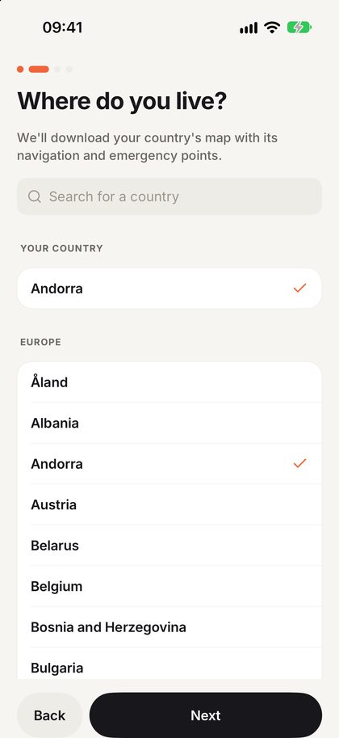</td>
    <td align="center" width="33%">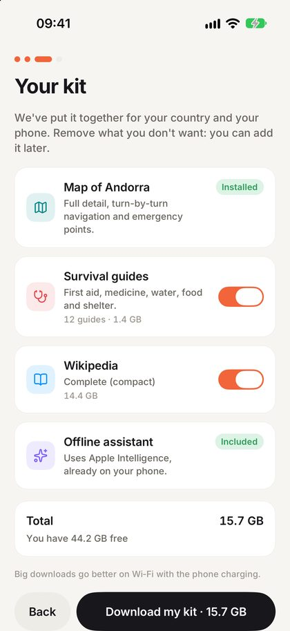</td>
  </tr>
  <tr>
    <td align="center"><b>1. Open the app</b><br>Language detected, nothing to configure.</td>
    <td align="center"><b>2. Pick your country</b><br>Preselected from your phone.</td>
    <td align="center"><b>3. Download your kit</b><br>One proposal sized for your country and your phone. Switch off what you don't want.</td>
  </tr>
</table>

That's it. Leave it on Wi‑Fi while it downloads; from then on everything works offline.
Home shows how prepared you are and what is missing, so you can complete it while you
still have a connection.

## What's inside

### 🆘 In an emergency

- **Emergency services nearby**: hospitals, pharmacies, police, fire stations, drinking
  water, shelters, defibrillators and more, sorted by distance and direction, with one tap
  to be guided there. Offline.
- **Call 112 / 911** in one tap and **share your position** (coordinates and UTM) by message.
- **First aid** one tap from Home.
- **Your family plan**: meeting points, contacts and everyone's medical details, also as a
  printable PDF.

<table>
  <tr>
    <td align="center" width="33%">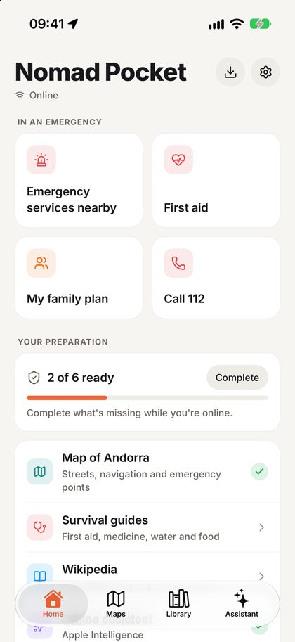</td>
    <td align="center" width="33%">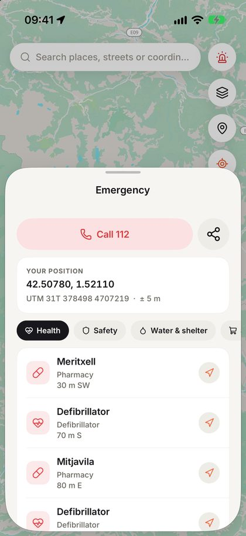</td>
    <td align="center" width="33%">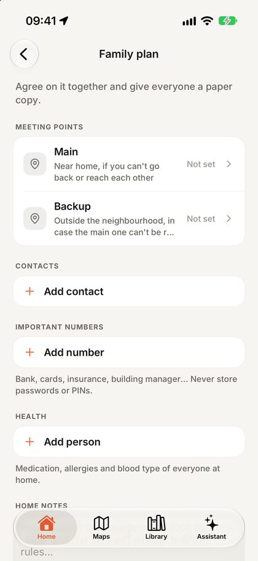</td>
  </tr>
</table>

### 🗺️ Offline maps and navigation

- **One download per country, with everything in it**: the map at full detail (every
  street, path and building), turn-by-turn routes by car, on foot and by bike, emergency
  points, and every street, place and house number for search ("Calle de Alcalá 50" lands
  on the door).
- **A world map built into the app**, so there is a map from the first second.
- Navigation view that follows you, compass beam, saved places, coordinates and UTM.
- Maps for every country; offline routing for the 60 countries of Europe and Latin
  America so far, with more coming.

<table>
  <tr>
    <td align="center" width="50%">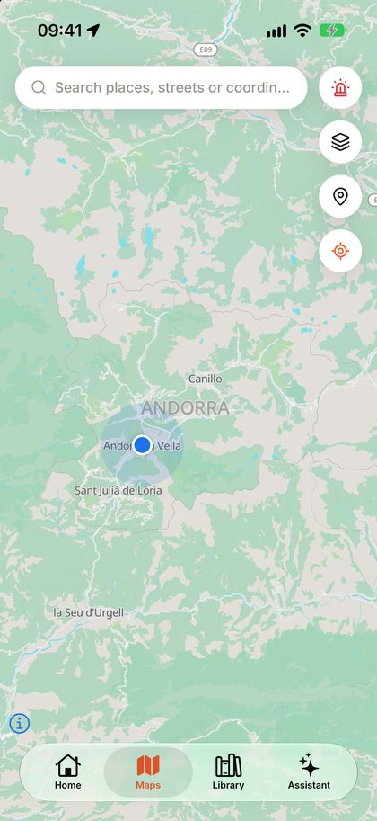</td>
    <td align="center" width="50%">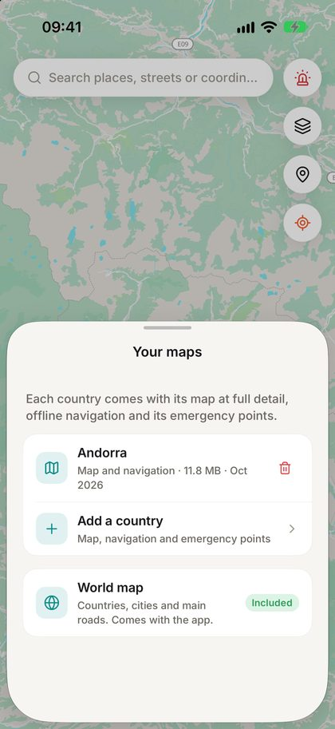</td>
  </tr>
</table>

### 📚 Knowledge library

- **Wikipedia**, sized to your storage: from the most-read articles (~250 MB) to the whole
  encyclopedia.
- **100+ curated collections**: medicine and first aid, survival, water and food,
  agriculture, DIY and repairs, computing. Plus thousands more from the
  [Kiwix](https://kiwix.org) catalog, or your own ZIM files.
- A reader with full-text search, bookmarks, find in page, text size and dark mode.
- **14 courses** (health, science, maths, programming…) with progress tracking.

### ✨ An AI assistant that runs on your phone

- Uses **Apple Intelligence** or **Gemini Nano** when your phone has them, or downloads an
  open model (Qwen 3.5, Gemma 4) that runs locally with llama.cpp.
- **Answers from your library, with sources** you can open: "How do I make water safe to
  drink?" works in the middle of nowhere.
- Nothing you ask ever leaves the device.

<table>
  <tr>
    <td align="center" width="50%">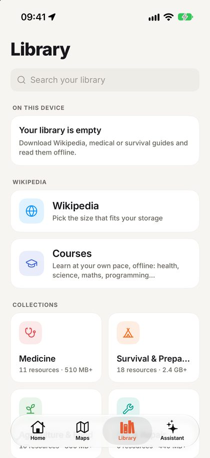</td>
    <td align="center" width="50%">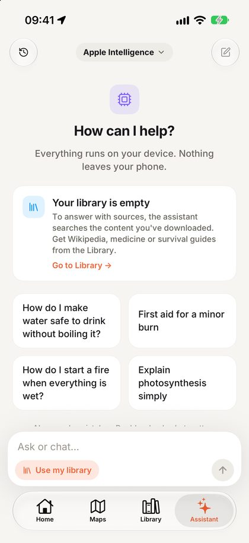</td>
  </tr>
</table>

### 🎒 Get prepared

- **Your preparation** on Home: map, guides, Wikipedia, assistant, family plan and
  emergency bag, each with its status, and a warning when your map is getting old.
- **Emergency bag checklist** sized to your household (litres of water, calories, days)
  with expiry reminders.

## Private by design

No account. No ads. No analytics. No tracking. Your plan, your contacts, your location and
your questions to the assistant stay on your phone. The app only goes online to download
the content you choose, from public servers (Kiwix, GitHub Releases, Protomaps, Hugging
Face). [Privacy policy](https://franlindebl.github.io/nomad-pocket/privacy.html).

## Open source, open data

Nomad Pocket is free software under the **GPL-3.0** license, built entirely on open
knowledge:

| Content | Source | License |
|---|---|---|
| Maps, routes, emergency points, addresses | [OpenStreetMap](https://www.openstreetmap.org) contributors, via [Protomaps](https://protomaps.com) and [Geofabrik](https://www.geofabrik.de) | ODbL |
| Wikipedia and the library | [Wikipedia](https://www.wikipedia.org) and others, packaged by [Kiwix](https://kiwix.org) | CC BY-SA and others |
| Routing engine | [Valhalla](https://github.com/valhalla/valhalla) | MIT |
| Country outlines | [Natural Earth](https://www.naturalearthdata.com) | Public domain |
| Local AI | [llama.cpp](https://github.com/ggml-org/llama.cpp), Qwen, Gemma | MIT, Apache-2.0, Gemma terms |

The country packages are built in the open: a monthly
[GitHub Actions workflow](.github/workflows/country-packages.yml) cuts each country's map,
builds its routing graph and extracts its emergency points, streets, places and house
numbers, and publishes them as [GitHub Releases](https://github.com/franlindebl/nomad-pocket/releases).
Anyone can audit or rebuild them.

### Contributing

Ideas, bug reports and pull requests are welcome. Good places to start:

- **Test it on your phone** and [open an issue](https://github.com/franlindebl/nomad-pocket/issues)
  with what broke or confused you.
- **Translations**: the app speaks Spanish and English (`src/i18n/locales`).
- **Content**: suggest collections for the catalog (`src/data/catalog.json`).
- **Countries**: help bring offline routing to more of the world (`scripts/routing/packs.json`).

## Status

Version **1.1.0** is in beta on TestFlight. The App Store release is in review and Google
Play is coming soon. Progress, backlog and known limits: [docs/PROGRESS.md](docs/PROGRESS.md).

## For developers

Expo SDK 58 · React Native 0.88 (New Architecture) · TypeScript · Expo Router · native
modules for libkiwix (ZIM), Valhalla (routing) and Apple Foundation Models / Gemini Nano ·
MapLibre with PMTiles · llama.rn · SQLite.

```bash
npm install            # also fetches the libkiwix and Valhalla iOS frameworks
npx expo run:ios       # or: npx expo run:android  (dev build; Expo Go won't work)
npm test               # unit tests
npx tsc --noEmit && npx expo lint && npm run check:i18n
npm run e2e            # Maestro functional suite on the iOS simulator
```

Requires Xcode 26+, Android Studio and Node 22.6+. Docs:
[Development](docs/DEVELOPMENT.md) · [Architecture](docs/ARCHITECTURE.md) ·
[Style guide](docs/STYLE_GUIDE.md) · [E2E tests](docs/E2E.md) · [Release](docs/RELEASE.md) ·
[Redesign plan](docs/UX_SURVIVAL_PLAN.md) · [Agent guide](CLAUDE.md)

## Disclaimer

Nomad Pocket is a preparedness tool, not a replacement for emergency services or
professional medical advice. Map data, emergency points and guides come from open sources
and can be incomplete or out of date. In an emergency, always call your local emergency
number.

## Credits and license

Inspired by [Project N.O.M.A.D.](https://github.com/Crosstalk-Solutions/project-nomad) by
Crosstalk Solutions. Made possible by Kiwix, Wikipedia, OpenStreetMap, Protomaps, MapLibre,
Valhalla and llama.cpp.

GPL-3.0-or-later. See [LICENSE](LICENSE).
